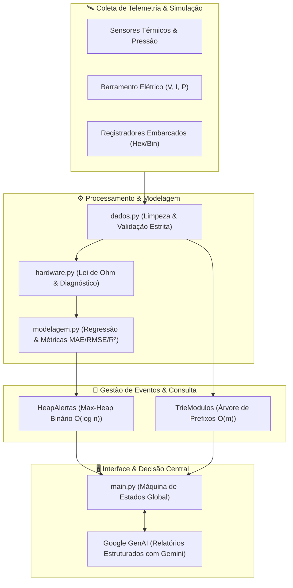
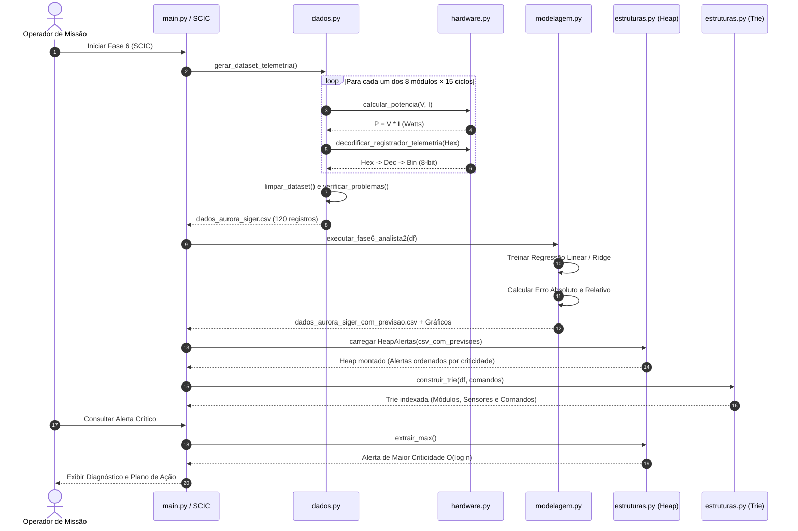
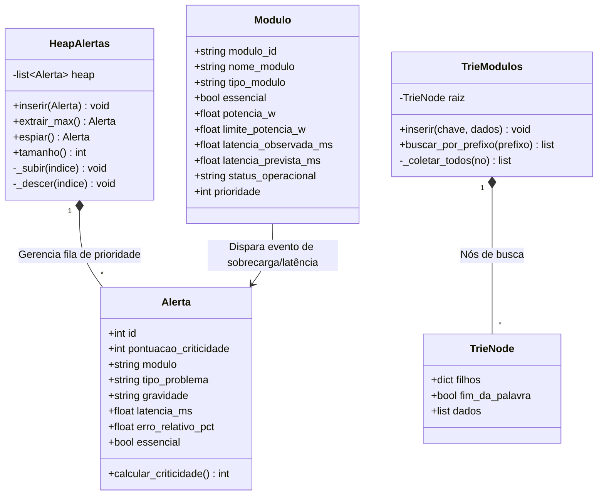

# 🛰️ Blueprint da Arquitetura & Registros de Decisão (ADR)

ARCHITECTURE
SYSTEM BLUEPRINT
STABLE

A arquitetura da **Missão Aurora Siger** foi projetada seguindo os princípios de engenharia de software aeroespacial: **isolamento de módulos**, **resiliência operacional sem conexão contínua com a Terra**, **invariantes matemáticos verificáveis** e **acesso determinístico a dados críticos**.

---

## 1. Visão Geral do Sistema (Mission Blueprint)

O sistema é dividido em três camadas funcionais:
1. **Camada de Simulação & Hardware**: Emulação de sensores, registradores de hardware (hex/bin), limites termodinâmicos e elétricos (Lei de Ohm e Potência).
2. **Camada Analítica & Cognitiva**: Processamento de dados via Pandas, regressão linear e regularizada (Ridge com Grid Search), lógica booleana e geração de relatórios com LLM (Google Gemini).
3. **Camada de Estruturas de Dados & Decisão**: Fila de prioridade com Max-Heap binário para alertas em tempo real e Árvore de Prefixos (Trie) para indexação instantânea de comandos e telemetria.

---

## 2. Pipeline de Execução e Ciclo de Vida dos Dados

O fluxo operacional do sistema une as etapas de geração de telemetria, modelagem estatística e alimentação das estruturas de busca e priorização:

---

## 3. Modelagem de Dados & Diagrama de Classes

---

## 4. Registros de Decisão Arquitetural (ADRs)

### ADR-001: Utilização de Max-Heap Binário para Gestão de Alertas Críticos
* **Contexto**: A colônia marciana opera sob telemetria contínua. Em situações de emergência (tempestade de areia, fuga térmica, sobrecarga em barramento), dezenas de alarmes chegam simultaneamente. A equipe precisa tratar imediatamente a falha com maior potencial catastrófico.
* **Alternativas Analisadas**:
  1. *Lista não ordenada*: Inserção $O(1)$, mas busca pelo alerta mais grave exige varredura completa $O(n)$.
  2. *Lista ordenada*: Extração $O(1)$, porém inserção exige deslocamento de elementos $O(n)$.
  3. *Max-Heap Binário*: Inserção em $O(\log n)$, extração em $O(\log n)$ e consulta do topo em $O(1)$.
* **Decisão**: Implementar `HeapAlertas` usando max-heap binário nativo com cálculo auditável de criticidade ponderada.
* **Consequência**: Garantia de tempo quase-constante para atendimento a emergências de suporte à vida.

---

### ADR-002: Indexação em Tempo de Execução via Árvore de Prefixos (Trie)
* **Contexto**: Operadores no terminal CLI precisam consultar rapidamente módulos (`MOD-01`, `MOD-02`), sensores hexadecimais (`0x2A`) ou comandos do console digitando prefixos abreviados.
* **Decisão**: Implementar `TrieModulos`, indexando os nomes dos módulos, identificadores, códigos de sensores e comandos do sistema.
* **Consequência**: O tempo de localização depende estritamente do tamanho do prefixo digitado $O(m)$ e não da quantidade total de módulos $O(n)$.

---

### ADR-003: Resiliência da Integração com LLM (Google Gemini) com Fallback Offline
* **Contexto**: A missão em Marte está sujeita a quedas no enlace de comunicação interplanetária (Blackout de rádio ou atrasos de sinal de até 22 minutos).
* **Decisão**: Toda chamada à API do Gemini (`google-genai`) possui tratamento de exceção estruturado e chave opcional. Se a chave não existir ou a rede falhar, o sistema reverte automaticamente para regras heurísticas locais de diagnóstico e análise sintética, sem travar a máquina de estados.
* **Consequência**: Sistema 100% tolerante a falhas de conectividade.

---

### ADR-004: Adoção do VitePress com Tema Marciano para Documentação Técnica
* **Contexto**: A documentação precisava combinar alta performance, dark mode temático imersivo, renderização nativa de diagramas Mermaid e deploy automatizado no GitHub Pages.
* **Decisão**: Adotar VitePress com plugin Mermaid nativo e tokens CSS inspirados em telemetria espacial marciana.
* **Consequência**: Carregamento instantâneo em qualquer navegador, suporte a busca offline e atualização contínua via GitHub Actions.
