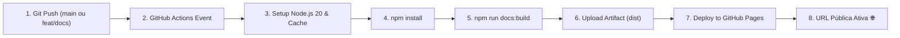

# 🚀 Deploy Contínuo & Publicação no GitHub Pages

<span class="mission-patch">DEVOPS</span>
<span class="mission-patch cyan">GITHUB PAGES</span>
<span class="mission-patch green">ACTIONS AUTOMATED</span>

A documentação da **Missão Aurora Siger** é compilada e publicada automaticamente no **GitHub Pages** por meio de um pipeline moderno de Integração Contínua (CI/CD) utilizando o **GitHub Actions**.

---

## 1. Fluxo de Publicação Automatizada

Cada alteração enviada às branches principais aciona o workflow de compilação:



---

## 2. Configuração do Workflow (`.github/workflows/deploy-docs.yml`)

O arquivo de pipeline automatiza a compilação do VitePress e publica o pacote no GitHub Pages:

```yaml
name: Deploy Mission Documentation to GitHub Pages

on:
  push:
    branches:
      - main
      - feat/docs
    paths:
      - 'docs/**'
      - '.github/workflows/deploy-docs.yml'
      - 'package.json'
  workflow_dispatch:

permissions:
  contents: read
  pages: write
  id-token: write

concurrency:
  group: 'pages'
  cancel-in-progress: true

jobs:
  build:
    runs-on: ubuntu-latest
    steps:
      - name: Checkout Codebase
        uses: actions/checkout@v4
        with:
          fetch-depth: 0

      - name: Setup Node.js
        uses: actions/setup-node@v4
        with:
          node-version: 20
          cache: npm

      - name: Install Documentation Dependencies
        run: npm ci || npm install

      - name: Build VitePress Static Site
        run: npm run docs:build

      - name: Upload GitHub Pages Artifact
        uses: actions/upload-pages-artifact@v3
        with:
          path: docs/.vitepress/dist

  deploy:
    environment:
      name: github-pages
      url: ${{ steps.deployment.outputs.page_url }}
    needs: build
    runs-on: ubuntu-latest
    steps:
      - name: Deploy to GitHub Pages
        id: deployment
        uses: actions/deploy-pages@v4
```

---

## 3. Configuração do Repositório no GitHub

Para que o deploy funcione na primeira execução, o administrador do repositório deve ativar o Pages:

1. Acesse **Settings** > **Pages** no repositório GitHub (`https://github.com/JFrois/PBL-Aurora/settings/pages`).
2. Em **Build and deployment** > **Source**, selecione: **GitHub Actions**.
3. Ao realizar um push ou disparar o workflow via botão **Run workflow** na aba **Actions**, o deploy será concluído e o link oficial ficará disponível em:
   `https://jfrois.github.io/PBL-Aurora/`

---

## 4. Resolução de Problemas Comuns (Troubleshooting)

::: warning [PROTOCOLO DE SEGURANÇA: CAMINHOS DE RECURSOS]
- **Erro 404 em assets (CSS/JS)**: Verifique se a variável `base` em `docs/.vitepress/config.mjs` está configurada como `'/PBL-Aurora/'` em ambiente de produção (o config já detecta `process.env.GITHUB_ACTIONS`).
- **Falha no build do Mermaid**: Certifique-se de que os blocos de código com diagramas usam a sintaxe correta do Mermaid e não contêm tags HTML soltas.
:::
