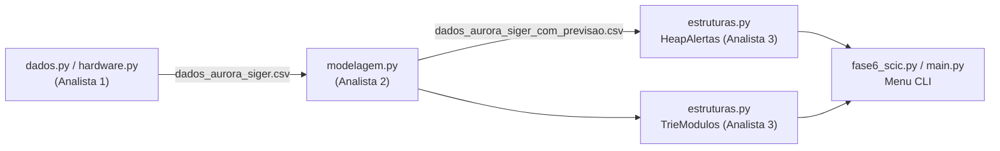
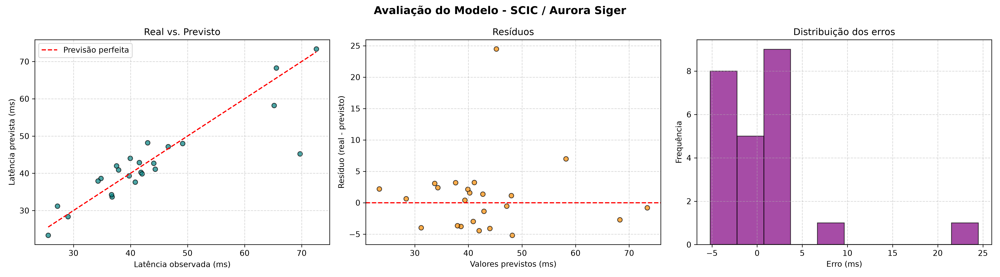
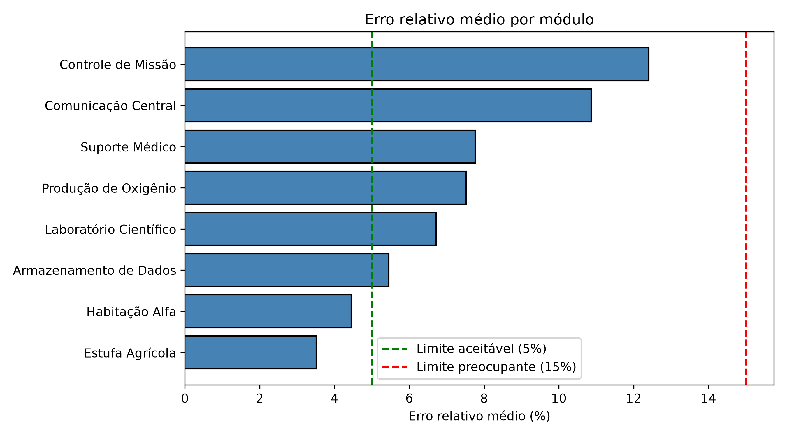
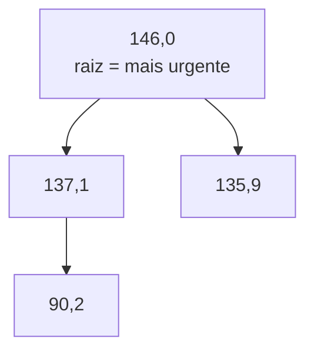

# Relatório Técnico - Fase 6: SCIC (Sistema Computacional Integrado da Colônia)

**Missão Aurora Siger · FIAP · 1CCOA-2026**

Equipe: Juan de Lucas Frois (RM563260) · Flávia Roberta Pennachin (RM561860) · Pedro Valente Toledo (RM570394)


## 1. Contexto

Após o pouso (Fase 2), a estabilização energética (Fase 3), a montagem da rede de infraestrutura (Fase 4) e o núcleo cognitivo (Fase 5), a colônia Aurora Siger precisa de um **sistema computacional integrado** capaz de:

1. coletar e validar a telemetria elétrica e de comunicação dos 8 módulos da base;
2. **prever a latência** de comunicação de cada módulo e medir o quanto a previsão erra;
3. **priorizar alertas** de forma que o problema mais grave seja tratado primeiro;
4. **localizar rapidamente** módulos, sensores e comandos durante uma operação.

O SCIC une esses quatro pontos num pipeline único:




## 2. Organização dos dados operacionais e de comunicação (Requisito 5.1)

### 2.1 A base simulada
- **Arquivo:** `data/processed/dados_aurora_siger.csv` — 120 registros (15 ciclos × 8 módulos), 20 colunas.
- **Reprodutibilidade:** o gerador usa `numpy.random.default_rng` com semente fixa (`42`). Qualquer execução produz exatamente a mesma base.
- **Estruturas em Python:** os 8 módulos ficam em uma lista de tuplas (`MODULOS`), cada registro é montado como dicionário e o conjunto final é um `DataFrame` do Pandas, salvo e lido em CSV.


| Grupo | Colunas |
|---|---|
| Registro | `timestamp_id`, `ciclo`, `data_registro` |
| Identificação | `modulo_id`, `nome_modulo`, `tipo_modulo`, `essencial`, `codigo_sensor_hex` |
| Ambiente | `temperatura_c`, `pressao_kpa`, `radiacao_msv` |
| Eletricidade | `tensao_v`, `corrente_a`, `potencia_w`, `limite_potencia_w` |
| Comunicação | `latencia_observada_ms`, `latencia_prevista_ms` |
| Alertas | `status_operacional`, `prioridade`, `mensagem_alerta` |


### 2.2 Como cada campo é gerado

Os valores são sorteados dentro de faixas físicas plausíveis:

- **Ambiente:** temperatura de −60 a 25 °C, pressão de 0,5 a 1,2 kPa e radiação de 0,1 a 2,5 mSv.
- **Potência elétrica:** $P = V \times I$ (`hardware.calcular_potencia`). Tensões de 220–240 V e correntes de 5–30 A resultam em potências de ~1,1 kW a ~7,2 kW. Quando $P$ ultrapassa o `limite_potencia_w` do módulo, o registro vira alerta de **sobrecarga no barramento**.
- **Lei de Ohm:** $R = V / I$ (`hardware.calcular_resistencia`) e `diagnosticar_circuito` apontam sobrecarga térmica.
- **Bases numéricas (COA):** cada sensor tem um código hexadecimal (ex.: `0x2A`). A conversão `0x2A → 42 (decimal) → 00101010 (binário, 8 bits)` emula a leitura de um registrador do hardware embarcado (`decodificar_registrador_telemetria`).


**Regra do status operacional** (avaliada nesta ordem; a primeira que valer define o status):
 
| Ordem | Condição | Status | Mensagem |
|---|---|---|---|
| 1 | Sorteio de 8% | `manutencao` | Manutenção preventiva agendada |
| 2 | `potencia_w > limite_potencia_w` | `alerta` | Sobrecarga de potência no barramento |
| 3 | `latencia_observada > 1,30 × latencia_prevista` | `alerta` | Latência acima do previsto |
| 4 | `radiacao_msv > 2,30` | `alerta` | Radiação elevada no módulo |
| 5 | Nenhuma das anteriores | `ativo` | Operação nominal |
 


### 2.3 Limpeza e validação

A leitura do CSV (`carregar_telemetria_csv`) e o salvamento (`salvar_telemetria_csv`) passam por duas funções:
 
- **`limpar_dataset`:** padroniza o texto do status (`strip` e minúsculas), remove duplicados por `timestamp_id` e descarta linhas com valores vazios.
- **`verificar_problemas`:** confere a presença das 20 colunas, valores nulos, faixas físicas (tensão 200–260 V, corrente 0–50 A, pressão 0,1–5 kPa, temperatura −100 a 60 °C, radiação 0–10 mSv, prioridade 1–4), latências positivas, status válido, código de sensor no padrão `0x..` e `timestamp_id` único. Verifica também que `potencia_w ≈ tensao_v × corrente_a`, com tolerância de 0,01W por causa do arredondamento em ponto flutuante.
Se qualquer problema for encontrado, **nada é salvo** e o erro lista o que está errado. Isso impede que dados inconsistentes cheguem ao modelo.


### 2.4 Indicadores operacionais 

A função `calcular_indicadores` resume a saúde da colônia:
 
| Indicador | Definição |
|---|---|
| `disponibilidade_%` | registros com status `ativo` ÷ total |
| `taxa_alertas_%` | registros com status `alerta` ÷ total |
| `em_manutencao_%` | registros com status `manutencao` ÷ total |
| `latencia_media_ms` | média da latência observada |
| `latencia_acima_do_previsto_%` | registros com observada > prevista ÷ total |
| `potencia_media_w` | média da potência |
| `registros_em_sobrecarga` | quantidade de registros com $P$ acima do limite |


## 3. Modelagem, erros e métricas (Requisito 5.2)

### 3.1 Erro absoluto e erro relativo

Para cada registro comparamos a latência observada ($y$) com a prevista ($\hat{y}$):

- **Erro absoluto:** $EA = |y - \hat{y}|$ (em ms) - Diz o *tamanho* do erro.
- **Erro relativo:** $ER = \dfrac{|y - \hat{y}|}{|y|}$, em % - Permite comparar módulos com escalas de latência diferentes.


O mesmo erro de 3 ms pesa muito mais em um módulo de latência baixa do que em um de latência alta. Por isso o relatório usa **os dois** indicadores, e não só um.


| Faixa | Critério | Ação esperada |
|---|---|---|
| **Aceitável** | $ER < 5\%$ | Nenhuma; o modelo descreve bem o comportamento do módulo |
| **Atenção** | $5\% \le ER < 15\%$ | Acompanhar; soma 8 pontos na criticidade do alerta |
| **Preocupante** | $ER \ge 15\%$ | Investigar; soma 20 pontos e o registro entra na fila de alertas |


O critério é o mesmo no código (`classificar_erro_relativo`) e neste relatório. Alguns pontos ajudam a interpretar:
 
- O erro **só é preocupante em contexto.** Um erro relativo de 15% em um módulo de latência baixa pode ser poucos milissegundos, irrelevante. O mesmo percentual em Suporte Médico ou Comunicação Central, módulos essenciais, pode ser o primeiro sinal de degradação do enlace. Por isso o heap soma o peso de "módulo essencial" à faixa de erro.
- O erro relativo **inflaciona** quando a latência observada é muito pequena (o denominador cai). Vale olhar sempre o erro absoluto junto.
- Um erro grande e **isolado** costuma ser um pico (ruído do enlace). Erros grandes **recorrentes** no mesmo módulo indicam desvio sistemático, como antena, cabo ou fonte degradados.


### 3.2 Ponto flutuante e aproximações

Computadores guardam números decimais em binário (IEEE 754), e muitos decimais "simples" não têm representação exata. O projeto demonstra isso em `demonstrar_ponto_flutuante`:
 
| Teste | Resultado |
|---|---|
| `0.1 + 0.2 == 0.3` | `False` (o resultado é `0.30000000000000004`) |
| `np.isclose(0.1 + 0.2, 0.3)` | `True` |
| Somar `0.1` dez vezes e comparar com `1.0` | `False`, com erro acumulado de ~1,1·10⁻¹⁶ |


Consequências práticas no SCIC:
1. **Nunca comparamos decimais com `==`.** A validação da potência usa tolerância de 0,01 W em vez de igualdade exata.
2. Diferenças da ordem de 10⁻¹⁶ são **ruído de representação**, não erro do modelo. O erro do modelo é da ordem de milissegundos, 15 ordens de grandeza maior.
3. Os valores são **arredondados** na geração (2 casas) e nas previsões. O arredondamento introduz diferenças de até 0,005 em cada valor, e isso também precisa caber na tolerância. Um registro com ER muito próximo de 5% ou de 15% pode mudar de faixa só por arredondamento, o que é mais uma razão para ver o erro como uma faixa, e não como um limite rígido.


## 4. Modelo de previsão e avaliação de desempenho (Requisito 5.3)

### 4.1 O modelo

 **Problema:** prever a **latência observada** (ms) de cada módulo (regressão).
- **Algoritmo:** Regressão Linear (`scikit-learn`).
- **Variáveis de entrada:** tensão, corrente, potência, temperatura, pressão, radiação, `prioridade` e `tipo_modulo` (codificado com One-Hot, `drop_first=True`). Ao todo são 14 variáveis.
- **Divisão:** 80% treino (96 registros) e 20% teste (24 registros), com semente fixa. Há ainda validação cruzada de 5 partes dentro do treino.
- **Cuidado com vazamento de dados:** a divisão treino/teste é feita **antes** do One-Hot, e as colunas do teste são alinhadas às do treino.
- **Saída:** o modelo gera a latência prevista para **todos** os registros, e o resultado é salvo em `dados_aurora_siger_com_previsao.csv`, com as colunas `erro_absoluto_ms`, `erro_relativo_pct`, `faixa_erro` e `conjunto` (treino ou teste). A estimativa de planejamento original é preservada em `latencia_prevista_original_ms`. Esse arquivo alimenta o Heap.


### 4.2 Métricas

| Métrica | Treino | Teste |
|---|---|---|
| MAE (ms) | 3,019 | 3,601 |
| MSE (ms²) | 21,939 | 34,418 |
| RMSE (ms) | 4,684 | 5,867 |
| R² | 0,885 | 0,776 |
| RMSE / MAE | 1,55 | 1,63 |

RMSE médio da validação cruzada: **5,75 ms**, coerente com o RMSE de teste (5,87 ms).


### 4.3 Interpretação 

- **MAE vs RMSE:** o RMSE eleva cada erro ao quadrado antes da média, então é mais sensível a *outliers*. Como RMSE/MAE ≈ 1,6, há poucos registros com erro grande: são os **picos de latência** (6% das leituras) que o modelo não tem como prever — erro máximo no teste foi de 24,49 ms, contra um erro médio de 3,60 ms.
- **R² = 0,78** no teste: o modelo explica ~78% da variação da latência. 
**Treino × teste.** O R² cai de 0,885 para 0,776. É um sinal de leve *overfitting*, esperado com 96 amostras para 14 variáveis.
- **Amostra pequena.** O teste tem só 24 registros, então cada métrica oscila bastante se a divisão mudar. Os percentuais de erro relativo (abaixo) correspondem a 9, 14 e 1 registro.
- **Limites do modelo linear.** O efeito da radiação sobre a latência na simulação é quadrático, e a temperatura entra em módulo. Um modelo linear só aproxima essas relações. Além disso, a potência é função de tensão × corrente, então essas três variáveis carregam informação parcialmente redundante.
**Erros no conjunto de teste:**
 
| Indicador | Valor |
|---|---|
| Erro absoluto médio / mediano | 3,60 ms / 2,85 ms |
| Erro relativo médio | 7,92% |
| Faixa aceitável (< 5%) | 37,5% (9 de 24) |
| Faixa de atenção (5% a 15%) | 58,3% (14 de 24) |
| Faixa preocupante (≥ 15%) | 4,2% (1 de 24) |

A mediana do EA (2,85 ms) menor que a média (3,60 ms) confirma que poucos erros grandes puxam a média para cima.

Saídas gráficas: `graficos_ou_imagens/avaliacao_modelo_scic.png` (real × previsto, resíduos, histograma) e `erro_relativo_por_modulo.png`, além de `dados_aurora_siger_com_previsao.csv` (com `erro_relativo_pct` e `faixa_erro`), que alimenta o Heap.


### Avaliação do modelo



### Erro relativo médio por módulo



## 5. Priorização de alertas com Heap (Requisito 5.4)

Código: `src/fase6_scic/estruturas.py` · Testes: `tests/test_estruturas.py` (6 testes, todos passando).


### 5.1 `HeapAlertas` — fila de prioridade para alertas críticos

**Problema:** a cada ciclo chegam alertas de vários módulos. O operador precisa sempre do **mais urgente** primeiro, e novos alertas continuam chegando enquanto os antigos são atendidos.

**Implementação:** *max-heap* binário implementado à mão sobre uma lista (sem usar `heapq`, para deixar explícitos o *sift-up* e o *sift-down*). O nó `i` tem filhos `2i+1` e `2i+2`; todo pai tem criticidade ≥ à dos filhos, então o alerta mais grave fica sempre na raiz. Em caso de empate, sai primeiro o **mais antigo**, para nenhum alerta ficar esquecido na fila (*starvation*).

**Quem entra na fila:** registros com `status_operacional == "alerta"`, com **sobrecarga** (`potencia_w > limite_potencia_w`) ou com erro de previsão **PREOCUPANTE**. Na base atual: **28 alertas** de 120 registros.


### 5.2 Critério de prioridade

A pontuação de criticidade é uma regra transparente e auditável. Cada parcela vira um "motivo" exibido ao operador:

| Fator | Pontos |
|---|---|
| Status `alerta` / `manutencao` | 40 / 10 |
| Sobrecarga de potência / Radiação elevada / Latência acima do previsto | 30 / 25 / 20 |
| Faixa de erro do modelo PREOCUPANTE / ATENÇÃO | 20 / 8 |
| Módulo essencial (suporte à vida, comunicação, controle) | 15 |
| Prioridade (1–4) | 5 × prioridade |
| Excesso de potência acima do limite | +1 por 1% |
| Latência observada acima da prevista | +0,5 por 1% (teto 40) |

**Exemplo de cálculo** (Controle de Missão, ciclo 15, o alerta do topo da execução): status `alerta` (40) + latência acima do previsto (20) + erro PREOCUPANTE (20) + módulo essencial (15) + prioridade 3 × 5 (15) + desvio de 71,9% × 0,5 (≈ 36) ≈ **146,0**. Os motivos exibidos ao operador são: *status=alerta, Latência acima do previsto, erro do modelo PREOCUPANTE, módulo essencial, latência 71,9% acima da prevista*.

A ordem de grandeza dos pesos reflete o risco: eletricidade (risco de incêndio) e radiação (saúde da tripulação) pesam mais que latência, mas a latência em módulos essenciais ainda sobe na fila porque soma vários fatores.


### 5.3 Como o heap organiza os alertas

Implementamos à mão um **max-heap binário** sobre uma lista Python (sem usar `heapq`), para deixar explícitos o *sift-up* e o *sift-down*:
 
- o nó na posição `i` tem filhos em `2i+1` e `2i+2` e pai em `(i-1)//2`;
- **invariante:** a criticidade de todo pai é maior ou igual à dos filhos, então o alerta mais grave fica **sempre na raiz** (posição 0);
- cada item é guardado como `(criticidade, -ordem_de_chegada, alerta)`. Em caso de **empate**, sai primeiro o alerta **mais antigo**, para nenhum alerta ficar esquecido na fila (*starvation*).

Exemplo ilustrativo com quatro alertas de pontuações 146,0 · 137,1 · 135,9 · 90,2:
 

 
**Inserir** (`inserir`): o alerta entra no fim da lista e **sobe** (*sift-up*) enquanto for mais crítico que o pai. No máximo a altura da árvore, ou seja, O(log n).
 
**Selecionar o mais urgente** (`espiar`, `extrair_mais_critico`): consultar o topo é O(1), pois ele é sempre a raiz. Para atender, trocamos a raiz com o último item, removemos o último e **descemos** (*sift-down*) o novo topo, trocando com o maior filho até restaurar a invariante. Isso custa O(log n).
 
**Top N sem remover** (`top_n`): trabalha em uma cópia do heap, extraindo N vezes, então a fila real não é alterada.
 
**Top 3 da execução** (na ordem de atendimento):
 
| # | Módulo | Ciclo | Criticidade |
|---|---|---|---|
| 1 | Controle de Missão (latência 71,9% acima da prevista) | 15 | 146,0 |
| 2 | Produção de Oxigênio | 6 | 137,1 |
| 3 | Suporte Médico | 13 | 135,9 |
 
Os três são módulos essenciais, com erro de previsão PREOCUPANTE, o que é coerente com a regra de pesos.


### 5.4 Vantagem sobre uma lista simples

| Operação | Lista não ordenada | Lista ordenada | **Heap** |
|---|---|---|---|
| Inserir alerta | O(1) | O(n) | **O(log n)** |
| Extrair o mais crítico | O(n) | O(1) | **O(log n)** |
| Consultar o topo | O(n) | O(1) | **O(1)** |
| Processar n alertas (inserir + extrair todos) | O(n²) | O(n²) | **O(n log n)** |

A lista é rápida em uma operação e lenta na outra. O heap é bom nas duas, que é o que importa com telemetria contínua.

**Benchmark** (`comparar_heap_vs_lista`: inserir n e extrair todos em ordem; tempos de uma execução, variam conforme a máquina):

| n | Lista (ms) | Heap (ms) | Ganho |
|---|---|---|---|
| 500 | 3,88 | 3,46 | 1,1× |
| 2 000 | 70,89 | 17,95 | 4,0× |
| 5 000 | 468,28 | 53,40 | 8,8× |

Com n pequeno a lista empata, porque as constantes pesam mais que a complexidade. Mas a diferença cresce junto com n, como a análise assintótica prevê: multiplicar n por 10 multiplicou o tempo da lista por ~120 (≈ quadrático) e o do heap por ~15 (≈ n log n).


## 6. Busca de registros com Trie (Requisito 5.5)

Durante uma emergência, o operador digita só o começo do nome ("com", "oxi", "0x2") e precisa achar o módulo, o sensor ou o comando na hora.


### 6.1 Implementação

Árvore de prefixos em que cada aresta é um caractere (`TrieModulos`). Os pontos principais:

- As chaves são **normalizadas** (minúsculas, sem acento), então `com`, `Com` e `comunicação` levam todas a *Comunicação Central*. 
- Cada módulo é indexado por várias chaves: nome completo, cada palavra do nome (`central`), `modulo_id` (`mod-02`), `tipo_modulo` e seus códigos hex. 
- Cada código de sensor é uma entidade própria, e a resposta já traz a conversão para decimal e binário;
- Os comandos do sistema (`/alertas`, `/diagnosticar`...) também entram. São **62 chaves** no total.
- Busca por prefixo usa DFS iterativa e devolve os resultados sem repetição e em ordem alfabética.

| Consulta | Resultado |
|---|---|
| `com` | MOD-02 – Comunicação Central |
| `0x2` | sensores 0x2A (dec 42, bin 00101010) e 0x2B (dec 43) |
| `mod-0` | os 8 módulos |
| `su` | MOD-05 – Suporte Médico |
| `di` | comando `/diagnosticar` |

A mesma Trie é usada na central de alertas: ao registrar um alerta manual, o operador digita um prefixo ("sup", "mod-05", "0x5") e escolhe o módulo entre os candidatos.


### 6.2 Por que a Trie é adequada

- **Complexidade:** inserir e buscar exato custam O(m), com m = tamanho da chave. 
- **Busca por prefixo** custa O(m + k):  m passos para chegar ao nó do prefixo e k para percorrer a subárvore com as respostas. Esse custo **não depende do número total de módulos**.
- Em uma lista, cada consulta compara o prefixo com todas as n chaves: **O(n·m)**.
- Como a busca é por prefixo, ela serve também de **autocompletar**: cada letra digitada já reduz as opções.

O custo é **memória**: a Trie guarda um nó por caractere, e várias chaves por módulo multiplicam isso. Para uma colônia, o ganho de tempo de resposta compensa.


## 7. Dispositivos, bases numéricas e eletricidade aplicada à comunicação (Requisito 5.6)
 
### 7.1 Dispositivos de entrada e saída
 
| Papel | Dispositivo | No protótipo |
|---|---|---|
| **Entrada** | Sensores e medidores de tensão, corrente, temperatura, pressão, radiação e latência | Simulados por `gerar_dataset_telemetria` |
| **Entrada** | Operador (teclado) | Menu do terminal, busca por prefixo, registro manual de alerta |
| **Armazenamento** | Arquivos CSV | `dados_aurora_siger.csv` e `dados_aurora_siger_com_previsao.csv` |
| **Saída** | Terminal (CLI) | Resumo da base, métricas, fila de alertas, resultados da busca |
| **Saída** | Relatório e gráficos | Este relatório e os arquivos `.png` |
| **Saída (conceitual)** | Dashboard em monitor | Indicadores de disponibilidade, alertas e latência por módulo |
 
**Interfaces de comunicação (conceituais).** O mapeamento de `mapear_interfaces_io` associa cada módulo a um protocolo coerente com sua função. Em uma instalação real, os dados do mesmo barramento também poderiam chegar por rede, USB, Wi-Fi ou Bluetooth até o terminal do operador.
 
| Módulo | Interface de comunicação | Barramento elétrico |
|---|---|---|
| MOD-01 Habitação Alfa | SpaceWire / Ethernet óptica | 230 V AC, Principal A |
| MOD-02 Comunicação Central | SpaceWire / link RF orbital | 230 V AC, Crítico Backup |
| MOD-03 Controle de Missão | CAN Bus redundante (ISO 11898) | 230 V AC, Primário |
| MOD-04 Laboratório Científico | Ethernet industrial / RS-485 | 230 V AC, Auxiliar |
| MOD-05 Suporte Médico | SpaceWire redundante, classe hospitalar | 230 V AC, Crítico Suporte à Vida |
| MOD-06 Estufa Agrícola | RS-485 Modbus RTU | 230 V AC, Agrícola High-Power |
| MOD-07 Armazenamento de Dados | PCIe Fabric / SpaceWire high-speed | 230 V AC, Computacional |
| MOD-08 Produção de Oxigênio | CAN Bus industrial redundante | 230 V AC, Suporte à Vida Crítico |
 

### 7.2 Códigos de sensor e bases numéricas
 
Cada módulo tem dois sensores, identificados por um código hexadecimal de 8 bits. Por convenção do projeto, o **nibble alto é o número do módulo** e o **nibble baixo (A ou B) é o sensor**. A leitura do código emula a de um registrador de hardware embarcado (`decodificar_registrador_telemetria`):
 
| Hexadecimal | Decimal | Binário (8 bits) | Leitura |
|---|---|---|---|
| `0x2A` | 42 | `0010 1010` | módulo 2 (Comunicação Central), sensor A |
| `0x2B` | 43 | `0010 1011` | módulo 2, sensor B |
| `0x8B` | 139 | `1000 1011` | módulo 8 (Produção de Oxigênio), sensor B |
 
Conversão passo a passo de `0x2A`: $2 \times 16 + 10 = 42$ (decimal) e $42 = 32 + 8 + 2 = 00101010_2$ (binário).
 
O hexadecimal é usado porque é compacto (1 dígito = 4 bits) e fácil de ler, enquanto o binário mostra o que o hardware realmente armazena.
 
 
### 7.3 Eletricidade básica
 
- **Potência:** $P = V \times I$ (`calcular_potencia`).
- **Resistência (Lei de Ohm):** $R = V / I$ (`calcular_resistencia`).
- **Diagnóstico:** `diagnosticar_circuito` compara $P$ com o limite do barramento e classifica como `NOMINAL` ou `CRÍTICO: Sobrecarga Térmica`.
| Caso | $V$ | $I$ | $P = V \times I$ | $R = V / I$ | Limite | Resultado |
|---|---|---|---|---|---|---|
| Nominal (padrão do menu) | 230 V | 28 A | 6 440 W | 8,214 Ω | 6 500 W | NOMINAL |
| Sobrecarga | 238 V | 29 A | 6 902 W | 8,207 Ω | 6 500 W | CRÍTICO (+6,2% acima do limite) |
 
No segundo caso, o excesso de 6,2% soma 6,2 pontos à criticidade, além dos 30 pontos fixos de "sobrecarga de potência". Ou seja, o cálculo elétrico alimenta diretamente a priorização do heap.
 
**Ligação com a comunicação.** Em um transmissor, a potência consumida é a base para estimar a potência de transmissão. Na simulação, assumimos que cada 1 000 W adicionais no módulo somam cerca de 3 ms à latência (premissa do gerador de dados, não uma lei física). Por isso a potência é uma das variáveis de entrada do modelo de regressão.
 


## 8. Gerenciamento inteligente da comunicação (Requisito 5.7)

- **Telemetria/IoT:** cada módulo funciona como um nó IoT. Ele publica a cada ciclo leituras de tensão, corrente, temperatura, pressão, radiação e latência, identificadas pelo código hex do sensor. Na Terra o equivalente seria MQTT/LoRa. Na colônia, os pacotes passam pela rede de infraestrutura da Fase 4, alimentando a base do SCIC com 120 leituras (15 ciclos × 8 módulos)
- **Monitoramento contínuo e detecção de anomalias.** Comparar a latência **observada** com a **esperada** pelo modelo, a cada ciclo, é uma detecção de anomalias. Dos 120 registros, **28 (23,3%)** entraram na fila de alertas por status de alerta, sobrecarga ou erro PREOCUPANTE. Os **picos** de latência (6% das leituras, com até 24,49 ms de erro no teste) são justamente os eventos que um monitoramento contínuo precisa capturar.
- **Automação e decisão rápida.** O heap transforma dezenas de alertas em uma **ordem de atendimento** em O(log n) por alerta, sem que o operador precise ler todos. A tela de atendimento encaminha o alerta mais crítico à equipe e deixa explícito que a **decisão final é do operador humano**: o sistema prioriza, não decide sozinho.
- **Armazenamento de dados e enlaces redundantes.** O módulo de Armazenamento de Dados (MOD-07) guarda a telemetria para análise posterior. Os módulos críticos já aparecem no mapeamento com **enlaces redundantes** (CAN Bus redundante em Controle de Missão e Oxigênio, SpaceWire redundante em Suporte Médico) e o barramento de Comunicação Central tem *backup*. Quando o heap indica degradação de latência em um módulo essencial, a redundância permite desviar o tráfego para o enlace reserva enquanto a equipe investiga
- **Redes inteligentes (*smart grid*):** com $P = V \times I$ calculado em tempo real e comparado ao limite, o SCIC enxerga sobrecargas antes de um desligamento. Em uma extensão, a informação de "módulo essencial" e de prioridade poderia orientar **quais cargas reduzir primeiro** (por exemplo, laboratório e estufa antes de suporte médico e oxigênio), aproveitando as rotas mínimas da Fase 4 para redistribuir a comunicação.
- **Manutenção preditiva:** o modelo de regressão dá a latência **esperada**. Quando a observada se afasta muito dela (faixa PREOCUPANTE), o equipamento está se comportando fora do padrão, o que pode indicar degradação de antena, cabo ou fonte. Esse desvio entra no Heap e gera uma ordem de manutenção **antes** da falha. Assim a colônia sai da manutenção corretiva e passa para a preditiva, economizando peças, energia e horas de trabalho, que são os recursos mais escassos em Marte.
- **Escalabilidade:** com mais módulos e sensores, o Heap (O(log n)) e a Trie (O(m + k)) mantêm o tempo de resposta adequado para operação em tempo real.


## 9. Reflexão social, cultural e sustentável (Requisito 5.8)

- **Decisão automatizada com responsabilidade:** o SCIC **prioriza**, mas não decide sozinho. A tela de atendimento diz explicitamente que a decisão final é do operador humano. Cada pontuação mostra seus **motivos**, para que a equipe possa auditar e contestar a ordem da fila. Um sistema que manda desligar o suporte médico sem explicar por que não é aceitável numa comunidade isolada.
- **Vieses dos pesos:** os pesos da criticidade são uma escolha de valor. Dar mais peso a módulos "essenciais" significa, na prática, que alguns grupos de trabalho (laboratório, agricultura) esperam mais. Essa regra precisa ser discutida com toda a colônia e revista periodicamente, não ficar escondida no código.
- **Limites do modelo:** R² = 0,78 quer dizer que ~22% da variação não é explicada. Picos de latência fora do padrão aparecem como erro grande, não como previsão. Por isso o modelo serve de apoio e não pode ser tratado como verdade absoluta.
- **Diversidade e acessibilidade:** a busca da Trie ignora acentos e maiúsculas, o que facilita o uso por tripulantes de línguas e teclados diferentes e por quem está sob estresse. Os códigos hex e os comandos dão uma linguagem comum, independente do idioma.
- **Cultura e trabalho:** automatizar a triagem reduz a carga cognitiva das equipes em turnos longos. Em contrapartida, exige treino para que as pessoas entendam o sistema e não percam a habilidade de operar sem ele, caso o computador falhe.
- **Sustentabilidade:** detectar sobrecargas e prever falhas evita queimar componentes que não podem ser repostos e reduz o desperdício de energia. Estruturas eficientes (O(log n) em vez de O(n)) também consomem menos processamento, e portanto menos energia, num ambiente em que cada watt conta.
- **Inspiração em conhecimentos tradicionais:** Muitas culturas indígenas orientam o uso de recursos pelo cuidado coletivo e pelo impacto de longo prazo. Essa ideia inspira o SCIC em dois pontos, priorizar a prevenção (manutenção preditiva, em vez de consertar depois que quebra) e tratar a energia e as peças como bens compartilhados e finitos da comunidade, e não como algo a ser consumido até acabar, assim evitando o colapso do ecossistema técnico da base antes que ocorra escassez de recursos vitais.


## 10. Limitações e trabalhos futuros
 
- **Base simulada.** Os dados seguem fórmulas conhecidas (por exemplo, o efeito quadrático da radiação), então o desempenho do modelo vale para a simulação, não para uma colônia real.
- **Amostra pequena.** São 96 registros de treino e 24 de teste. Mais ciclos dariam métricas mais estáveis.
- **Modelo simples.** A regressão linear não captura relações não lineares nem os picos. Como trabalho futuro, comparar com Ridge ou modelos não lineares usando Grid Search, AIC e BIC.
- **Evolução temporal.** Não foi implementada simulação numérica da latência ao longo do tempo. Uma extensão natural seria evoluir a latência ciclo a ciclo com um método simples (como Euler).


## 11. Como executar

```bash
# Orquestrador independente da Fase 6 (menu interativo)
python -m src.fase6_scic.fase6_scic

# Pipeline completo sem menu
python -m src.fase6_scic.fase6_scic --auto

# Pelo orquestrador geral (Fase 6 → opções 4 a 7)
python main.py

# Testes das estruturas
pytest tests/test_estruturas.py
```

**Menu do SCIC** (`fase6_scic.py`):
 
| Opção | Função |
|---|---|
| 1 | Gerar e persistir a base de telemetria e treinar o modelo |
| 2 | Diagnóstico de circuito elétrico (Lei de Ohm) |
| 3 | Mapear interfaces de I/O e transmissão |
| 4 | Decodificar registrador hexadecimal |
| 5 | Central de alertas críticos (Heap) |
| 6 | Busca por prefixo (Trie) |
| 7 | Benchmark Heap × lista comum |
| 8 | Pipeline completo (dados → modelo → heap → trie) |
 


## 12. Conclusão

O SCIC fecha o ciclo da missão: os dados elétricos e de comunicação são coletados e validados, um modelo estatístico estima o comportamento esperado da rede e mede os próprios erros, e duas estruturas de dados avançadas transformam esses números em ação. O Heap decide **o que atender primeiro** e a Trie mostra **onde está** cada recurso. Tudo isso com decisões explicáveis e supervisão humana.
