# Relatório Técnico - Fase 7 
# SIFSM (Sistema Integrado de Futuro Sustentável em Marte)

**Missão Aurora Siger · FIAP · 1CCOA-2026**

Equipe: Juan de Lucas Frois (RM563260) · Flávia Roberta Pennachin (RM561860) · Pedro Valente Toledo (RM570394)


## 1. Contexto e visão geral 

A operação da colônia Aurora Siger exige acompanhar recursos, identificar situações de atenção e avaliar
alternativas antes de modificar a infraestrutura. Leituras isoladas não mostram, por si só, a energia
acumulada, a autonomia de armazenamento ou as limitações de uma estimativa de consumo.

O SIFSM integra organização dos dados, banco de dados, lógica booleana, estruturas de dados,
simulação computacional, modelagem linear e agentes simulados. Seu objetivo é apoiar o planejamento
energético e a revisão de condições operacionais, preservando supervisão humana nas decisões críticas.

A interface principal é o menu textual de `codigo_fonte.py`. O Integrante 1 entrega dados, banco, CRUD, 
lógica e estruturas de dados (opções 1 a 7 e U). O Integrante 2 entrega simulação, regressão, agentes e 
análise integrada (opções 8, 9, 10 e A), com gráficos e documentação. O Integrante 3 entrega arquitetura 
e análise socioambiental (opções 11 e 12).


## 2. Dados e banco de dados (Integrante 1) | **Requisito 5.1**

**Escolha do banco.** SQLite (`sqlite3`, biblioteca padrão do Python). O Oracle do material do curso exige
servidor e credenciais; o SQLite roda em qualquer máquina sem instalação, o que permite ao avaliador
executar o projeto. O esquema está em `data/fase7/script_banco.sql` e o banco (`aurora_siger.db`) é criado
na primeira execução.

**Tabelas.**

| Tabela | Conteúdo | Observações |
|---|---|---|
| `modulos` | os 8 módulos da colônia (id, nome, tipo, `essencial`, `limite_consumo_w`, status) | `essencial = 1` define o módulo crítico da regra booleana |
| `sensores` | código hexadecimal (ex.: `0x1A`), módulo e tipo | herdados da Fase 6 |
| `leituras` | consumo (W), temperatura, umidade, carga da bateria, status, data | tabela principal do CRUD |
| `alertas` | alertas gerados pela regra booleana | ligados à leitura de origem |
| `chamados` | solicitações da tripulação | alimentam a fila (FIFO) |

As restrições do próprio banco (`CHECK`, chaves estrangeiras, `NOT NULL`) funcionam como segunda barreira de
validação: consumo negativo, umidade fora de 0-100 ou módulo inexistente são rejeitados mesmo se a validação
em Python falhar.

**Base simulada.** `data/fase7/dados_aurora_siger.csv` tem 120 leituras (8 módulos x 15 ciclos de 6 h),
geradas de forma determinística por `src/fase7_sifsm/dados_simulados.py` (semente 42). O consumo depende
linearmente da temperatura e da umidade, com ruído, para sustentar a regressão linear (seção do Integrante 2).
Foram injetados 7 picos de consumo, 1 falha de sensor e 1 manutenção, para exercitar a regra de decisão.

**CRUD** (`src/fase7_sifsm/banco.py`, opções 1 a 4 do menu):

| Operação | Função | Cuidados |
|---|---|---|
| Cadastrar | `cadastrar_leitura` | valida e grava a leitura; no menu, `opcao_cadastrar` também classifica o risco e registra alerta quando aplicável |
| Desfazer | `opcao_desfazer` | utiliza a pilha da sessão para reverter cadastro, alteração ou exclusão; `restaurar_leitura` é utilizada para reinserir uma leitura excluída |

O histórico de desfazer permanece apenas em memória e é reiniciado ao encerrar o programa. Consultas, 
simulações e conversas com os agentes não são incluídas nessa pilha. Quando ela está vazia, a opção U 
informa que não há ações para desfazer.

Os alertas persistidos não são automaticamente sincronizados após todas as alterações de leituras. 
A listagem e a análise integrada recalculam o risco das leituras consultadas, mas isso não equivale a 
atualizar o histórico de alertas armazenado.

**Tratamento de erros.** Entradas inválidas levantam `ErroBanco` com mensagem clara (ex.: "O campo
'consumo_w' deve ser numérico (recebido: 'abc')"). As operações usam `try/except/else/finally`: `except` converte
erros do SQLite em mensagens para o usuário e faz `rollback`; `else` devolve o resultado; `finally` fecha a
conexão. O menu captura `ErroBanco`, `ValueError` e `sqlite3.Error` sem encerrar o programa.

**Segurança.** Todas as consultas são parametrizadas (`?`); nomes de coluna só vêm de listas fixas. Há teste
automatizado de tentativa de SQL injection (`tests/test_fase7_banco.py`).


## 3. Regra booleana e circuito lógico (Integrante 1) | **Requisito 5.2**

Variáveis: **A** = `CONSUMO_ELEVADO` (consumo > 90% do limite do módulo), **B** = `MODULO_CRITICO`
(módulo essencial), **C** = `SENSOR_VALIDO` (leitura confiável: sem falha e com valores plausíveis).

- `ALERTA = A AND B AND C`
- `BLOQUEIO = NOT C` (não decidir com base em sensor inválido)
- De Morgan: `NOT ALERTA = (NOT A) OR (NOT B) OR (NOT C)`

| A | B | C | ALERTA | BLOQUEIO |
|---|---|---|:---:|:---:|
| 0 | 0 | 0 | 0 | 1 |
| 0 | 0 | 1 | 0 | 0 |
| 0 | 1 | 0 | 0 | 1 |
| 0 | 1 | 1 | 0 | 0 |
| 1 | 0 | 0 | 0 | 1 |
| 1 | 0 | 1 | 0 | 0 |
| 1 | 1 | 0 | 0 | 1 |
| 1 | 1 | 1 | **1** | 0 |

A função `classificar_risco` traduz a regra em quatro níveis: `bloqueado` (sensor inválido), `alto`
(alerta), `medio` (consumo elevado em módulo não crítico) e `baixo`. Está em `src/fase7_sifsm/logica.py`
e é usada pelo cadastro, pela listagem, pelo heap de alertas e pelos módulos do Integrante 2.

**Circuito.** `docs/fase7/graficos_ou_imagens/circuito_logico.png`: duas portas AND em cascata (A, B -> AND; saída e C -> AND) ligadas
ao LED vermelho de ALERTA, e um inversor ligado ao LED amarelo de BLOQUEIO. A montagem no Tinkercad (portas
74HC08/74HC04 ou Arduino Uno, com o código `docs/fase7/tinkercad/sifsm_alerta.ino`) está descrita em
`docs/fase7/tinkercad/README.md`. A tabela de teste do circuito é a mesma do sistema (opção 5 do menu).


## 4. Estruturas de dados (Integrante 1) | **Requisito 5.3**

| Estrutura | Uso na colônia | Por que | Custo |
|---|---|---|---|
| Fila (FIFO) | chamados da tripulação | justiça: o primeiro chamado é o primeiro atendido | enfileirar e atender O(1) |
| Pilha (LIFO) | histórico de ações do CRUD, para desfazer | a última ação é a primeira a ser revertida | inserção usual e remoção do topo O(1); descarte do elemento mais antigo O(n) |
| Tabela hash (encadeamento) | busca de sensor por código hexadecimal | acesso direto ao sensor/módulo; colisões tratadas com listas | O(1) médio |
| Heap máximo (Fase 6) | alertas, do mais crítico ao menos crítico | sempre atende primeiro o mais grave | inserir e extrair O(log n) |

A tabela hash é implementada manualmente (função de hash polinomial, redimensionamento com fator de carga
0,75) em `src/fase7_sifsm/estruturas.py`. O heap reaproveita `HeapAlertas` da Fase 6 por meio de
`montar_heap_de_alertas`, que converte as leituras da Fase 7 para o formato da Fase 6. A opção 7 do menu
demonstra as quatro estruturas com dados reais do banco.

Na opção A, as últimas leituras são classificadas e ordenadas por prioridade. Uma fila `deque` percorre os 
módulos nessa ordem de revisão. Essa fila é distinta do heap demonstrado na opção 7. O risco exibido na análise 
integrada corresponde à última leitura de cada módulo, não ao pior evento de todo o histórico.

## 5. Simulação computacional e integração matemática (Integrante 2) | **Requisito 5.4**

O módulo `src/fase7_sifsm/simulacao.py` implementa a organização das leituras, a integração numérica e a simulação de armazenamento. 
O arquivo `simulacao_computacional.py`, na raiz do projeto, oferece a execução independente dessas funcionalidades. 
A opção 8 do menu principal utiliza o mesmo módulo de simulação.


### 5.1 Variáveis e unidades

| Variável | Significado | Unidade ou domínio |
|---|---|---|
| `data_registro` | Instante da leitura | Data e hora |
| `consumo_w` | Potência elétrica informada pela leitura | W |
| `modulo_id` | Identificação do módulo | Código |
| `essencial` | Indica módulo essencial | 0 ou 1 |
| `tempos_h` | Tempo desde o primeiro instante completo | h |
| `energia_wh` | Energia acumulada no intervalo | Wh |
| `potencia_media_w` | Energia dividida pela duração | W |
| `capacidade_wh` | Capacidade energética ideal da bateria | Wh |
| `geracao_w` | Potência de geração adotada | W |
| `soc` | Fração de energia disponível em relação à capacidade | 0 a 1 |
| `deficit_wh` | Energia acumulada não atendida após esgotamento | Wh |

Embora o campo se chame `consumo_w`, seu valor representa potência. A energia consumida é obtida
integrando essa potência ao longo do tempo.

### 5.2 Organização das leituras e cálculo da energia

A consulta usa `listar_leituras(limite=None, ordem="asc")`, evitando restringir a análise ao limite
padrão de 50 registros. O código organiza leituras por data e módulo, rejeita duplicatas e seleciona
instantes com todos os módulos encontrados na consulta. Ausência não é convertida em consumo zero.
Um módulo ausente de toda a consulta não é detectado por esse critério, o que limita a completude da análise.

O consumo total de cada instante corresponde à soma das potências dos módulos. O horizonte é de até
24 horas, limitado aos dados disponíveis. Se o término estiver entre duas leituras, a potência final
é interpolada linearmente.

A regra dos trapézios aproxima a integral por:

```text
E ≈ Σ [(P_i + P_(i+1)) / 2] × (t_(i+1) − t_i)
```

Como P está em watts e t em horas, E resulta em watt-hora. A potência média é:

```text
P_média = E / duração
```

A implementação manual com laço `for` torna explícito o cálculo da área sob a curva, conforme o
conteúdo de integração numérica do capítulo 6. A aproximação assume segmentos de reta entre amostras;
intervalos grandes podem ocultar variações intermediárias.

### 5.3 Comparação de cenários

O cenário original utiliza as leituras sintéticas do banco. O cenário eficiente aplica redução
hipotética de 15% somente nos módulos marcados como não essenciais. São criadas cópias das leituras,
sem modificar o banco. A economia é a diferença entre as energias dos dois cenários, no mesmo intervalo.

A redução de 15% é uma hipótese didática, não uma eficiência comprovada. A marcação de módulo não
essencial também não autoriza desligamento indiscriminado: uma revisão real exigiria avaliar dependências
e necessidades da tripulação.

### 5.4 Bateria e balanço energético

A bateria ilustrativa possui capacidade de 100.000 Wh (100 kWh), carga inicial de 80%, horizonte de
48 horas e passo de 0,5 h. O consumo é constante e igual à potência média do cenário original;
a geração constante corresponde a 80% desse consumo. Esses parâmetros são escolhas do modelo.

```text
E_bateria,seguinte = E_bateria,atual + (P_geração − P_consumo) × Δt
SoC = E_bateria / capacidade
```

A energia é limitada entre zero e a capacidade. Quando a demanda supera a energia disponível,
o modelo acumula energia não atendida. O último passo é ajustado ao horizonte solicitado.

O capítulo 6 apresenta estado de carga por integração da corrente e capacidade em Ah. Aqui, o princípio
de acumulação é adaptado para potência em W e capacidade em Wh. Não se trata de contagem de Coulomb
implementada diretamente nem de um modelo eletroquímico.

### 5.5 Gráficos, resultados e limitações

São gerados `consumo_cenarios.png` e `bateria.png` em `docs/fase7/graficos_ou_imagens/`.
O primeiro compara potências no tempo; o segundo mostra carga percentual. No modelo da bateria,
a demanda média constante não reproduz cada oscilação da série de consumo.

Não há perdas de conversão, envelhecimento, limites de corrente, efeitos térmicos ou geração variável.
Leituras sintéticas em falha permanecem na comparação energética como valores hipotéticos, sem validade
para decisões operacionais. A regra de risco trata a confiabilidade separadamente.

Os totais de energia e economia devem ser obtidos na execução da opção 8 e associados à versão
do banco utilizada. A simulação apoia comparação e planejamento, sem comprovar economia real.


## 6. Modelo linear e interpretação dos resultados (Integrante 2) | **Requisito 5.5**

`src/fase7_sifsm/modelo_linear.py` utiliza Pandas, NumPy, Matplotlib e `LinearRegression`, do scikit-learn, para estimar consumo.

### 6.1 Variáveis e preparação

O alvo é `consumo_w` (W). As entradas são `temperatura_c` (°C) e `umidade_pct` (%).
Essas duas variáveis participam da geração dos dados sintéticos. A carga da bateria não foi usada
como entrada porque é gerada separadamente, sem relação direta definida com o consumo nesse gerador.

A preparação converte valores numéricos e datas, remove ausências e valores não finitos, rejeita faixas
inválidas e exclui leituras com status `falha`. Os picos de consumo são mantidos: removê-los apenas para
melhorar métricas ocultaria uma dificuldade do problema.

Na execução informada pela equipe, 120 registros foram recebidos e 119 utilizados.

### 6.2 Análise exploratória

São apresentados estatísticas descritivas, médias por módulo, gráficos de dispersão e matriz de
correlação. Na base executada, o consumo médio foi 3.019,19 W, com mínimo de 2.282,84 W e máximo
de 7.569,00 W. A diferença entre média, mediana de 2.818,25 W e máximo evidencia valores elevados
que merecem inspeção.

As correlações observadas foram aproximadamente:

| Par de variáveis | Correlação |
|---|---:|
| Temperatura e consumo | 0,540 |
| Umidade e consumo | 0,136 |
| Temperatura e umidade | 0,630 |

Essas associações não demonstram causalidade. A correlação entre entradas é uma verificação inicial;
não foi calculado VIF e não se conclui, apenas com esses valores, que há multicolinearidade grave
ou que ela foi descartada.

### 6.3 Treinamento e coeficientes

A separação é temporal: os primeiros 80% dos instantes são usados para treinamento e os restantes
para teste. O mesmo instante não aparece nos dois conjuntos. Na execução registrada, foram 95 leituras
para treino e 24 para teste, começando em **2026-10-04 00:00:00**.

A equação ajustada foi:

```text
Consumo estimado (W) = −1491,83
                      + 228,35 × temperatura_c
                      − 16,41 × umidade_pct
```

Mantendo a outra variável constante, +1 °C está associado a +228,35 W e +1 ponto percentual de
umidade a −16,41 W no ajuste. O intercepto representa o valor matemático com entradas iguais a zero,
condição fora das faixas observadas, sem interpretação física direta neste estudo.

O coeficiente negativo da umidade não prova que aumentar umidade reduz consumo. O modelo agrupa
módulos com características diferentes e contém picos, o que pode alterar a interpretação dos coeficientes.
Ele não recupera necessariamente os parâmetros usados para gerar a base sintética.

### 6.4 Avaliação e apoio à decisão

Resultados apresentados no terminal pela equipe:

| Métrica | Valor |
|---|---:|
| MAE | 589,07 W |
| MSE | 784.937,04 W² |
| RMSE | 885,97 W |
| R² no teste | 0,355 |
| MAE da referência pela média do treino | 555,51 W |

MAE e RMSE expressam erros em watts; o MSE está em watts ao quadrado e penaliza erros grandes.
R² não é porcentagem de acertos. Seu valor descreve a redução do erro quadrático em relação à
referência da média do próprio conjunto de teste usada na definição dessa métrica.

**O modelo não superou a previsão constante pela média do treino em MAE.** Assim, não foi demonstrada
vantagem preditiva nessa métrica nem adequação para controle operacional. A comparação de MAE e o R²
utilizam referências diferentes, portanto não são resultados contraditórios.

São gerados `analise_exploratoria.png`, `regressao.png` e `residuos.png`. Resíduos são observados menos
previstos. Padrões, dispersão variável e erros extremos devem ser examinados; os gráficos, por si só,
não demonstram atendimento a todas as hipóteses estatísticas da regressão.

Para condições ilustrativas de 22,51 °C e 40,4% de umidade, o sistema estimou aproximadamente
2.985,2 W. Trata-se de estimativa condicional, não de previsão de um ciclo futuro, de um módulo
específico calibrado separadamente ou de risco de falha. O MAE não constitui intervalo de confiança
nem limite garantido de erro. Entradas fora das faixas individuais do treino são rejeitadas; estar dentro
dessas faixas não garante que a combinação tenha sido observada ou que a estimativa seja confiável.

O uso proposto é discutir planejamento energético e necessidades de revisão. Antes de orientar mudanças,
seriam necessários mais dados, validação externa e melhoria do desempenho. Alterações no banco podem
modificar os resultados apresentados nesta seção.


## 7. Agentes, guardrails e integração de IA (Integrante 2) | **Requisito  5.6**

A proposta implementa uma simulação de arquitetura multiagente com
funções Python em `src/fase7_sifsm/agentes.py`. Não há LLM, Agents SDK, RAG, webhook ou plataforma
low-code em execução nesse fluxo.

### 7.1 Papéis e ferramentas

| Agente | Responsabilidade | Ferramenta ou fonte |
|---|---|---|
| Triador | Identificar o assunto por palavras-chave e encaminhar | Regras de roteamento |
| Energia | Explicar estimativa de consumo e seus limites | `ferramenta_prever_consumo` → `modelo_linear.py` |
| Manutenção | Apresentar risco da última leitura e orientação consultiva | `ferramenta_classificar_risco` → `logica.py` |
| Dados | Informar quantidade e data dos registros consultados | `ferramenta_consultar_leituras` → `banco.py` |

Uma solicitação sobre bateria remete à opção 8, sem inventar telemetria. O triador não calcula o risco:
transfere o atendimento ao especialista, que utiliza a ferramenta. Esse encaminhamento é o handoff
simulado. Não há interpretação livre de linguagem natural.

### 7.2 Fluxo determinístico e memória

```text
Entrada → guardrail de entrada → triador → handoff → especialista
        → ferramenta determinística → explicação padrão
        → guardrail de saída → resposta + histórico + tracing
```

A sessão mantém o módulo informado para consultas seguintes. Exemplo: após `consumo MOD-01`,
a pergunta `e o risco?` reutiliza esse módulo. Um código inexistente não substitui o contexto válido.
A consulta `dados de todos os módulos` remove o filtro de módulo.

O histórico mantém até 20 interações aceitas e a trilha, até 100 eventos. Ambos ficam em memória,
sem gravação em disco. Pedidos rejeitados não são armazenados no histórico. Histórico textual ainda
pode conter informações digitadas em pedidos aceitos; por isso a equipe deve usar apenas dados fictícios
na demonstração e limpar a sessão quando necessário.

O menu oferece atalhos numerados, consultas textuais e comandos para `histórico`, `trilha`, limpeza da sessão e saída. 
As consultas utilizam o mesmo fluxo de guardrails, roteamento e ferramentas.

Quando uma entrada está fora da faixa de treinamento, a estimativa é recusada. A resposta identifica o módulo, 
a data da leitura, a variável e os limites utilizados, orientando a conferência do registro. 
Uma medição válida não deve ser modificada apenas para se enquadrar no modelo. 
A consulta de risco utiliza a regra booleana e é distinta da estimativa de consumo.

### 7.3 Guardrails, segurança e responsabilidade humana

O guardrail de entrada verifica texto vazio, limite de 1.000 caracteres, escopo e termos relacionados
a ações perigosas, alterações de registros ou credenciais. O de saída rejeita determinadas alegações
de ação executada ou certeza indevida e exige menção à validação humana.

São verificações heurísticas: podem rejeitar frases inocentes e deixar passar formulações inesperadas.
Não garantem segurança completa nem verificam toda a fidelidade factual de uma resposta.
A barreira principal é estrutural: as ferramentas expostas aos agentes só consultam e calculam;
não cadastram, alteram ou excluem registros, nem operam suporte de vida ou outros equipamentos.

A classificação de risco permanece na regra booleana. A regressão apenas estima consumo e sua avaliação
insatisfatória em MAE é comunicada pelo especialista de energia. Nenhuma recomendação equivale a autorização
para atuar. A validação humana é uma responsabilidade externa ao protótipo, não um fluxo de aprovação
operacional implementado.

### 7.4 Integração opcional com LLM e fallback

O projeto possui `src/core/ia.py` como ponto de integração opcional com Gemini. Neste fluxo, a integração
é uma proposta conceitual; não se afirma que os agentes revisados chamam esse módulo.

```text
Entrada validada → triador → especialista → ferramentas determinísticas
→ resultados calculados + explicação padrão
→ Gemini opcional, apenas para redigir explicação
→ verificar preservação dos resultados e limites
→ guardrail de saída → resposta

Sem chave, com falha ou com resposta rejeitada:
explicação determinística → guardrail de saída → resposta
```

Uma implementação futura precisaria verificar que o texto preserva valores e classificações, não inventa
fontes ou autoriza ações. O guardrail atual não faz sozinho essa verificação. O LLM não receberia poderes
para alterar regras, dados ou equipamentos. O funcionamento básico continuaria independente de API.


## 8. Arquitetura computacional, processamento e aceleração (Integrante 3) | **Requisito 5.7**

### 8.1 Pipeline de processamento do SIFSM e execução local

O SIFSM estrutura seu fluxo computacional em cinco estágios determinísticos desacoplados, projetados para operar localmente sem dependência obrigatória de serviços remotos:

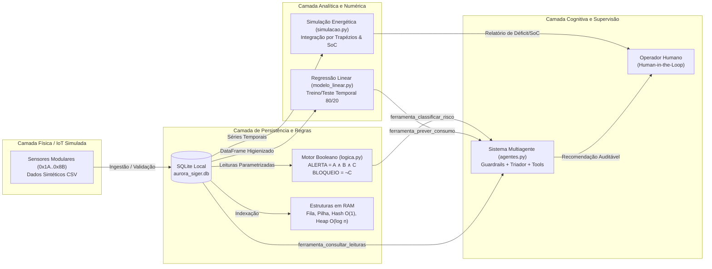

1. **Aquisição IoT simulada e validação (`dados_simulados.py` / `banco.py`):** Os 16 sensores distribuídos nos 8 módulos (`MOD-01` a `MOD-08`) geram leituras de potência (`consumo_w`), temperatura (`temperatura_c`), umidade (`umidade_pct`), carga de bateria (`carga_bateria_pct`) e status a cada ciclo de 6 h. Antes da gravação, `validar_leitura()` higieniza tipos, verifica finitude (`math.isfinite`) e impõe limites físicos.
2. **Persistência transacional (`sqlite3`):** O banco embarcado `aurora_siger.db` armazena os registros em disco local sem exigir servidor dedicado. Índices compostos (`idx_leituras_modulo_data`, `idx_alertas_modulo`) aceleram filtros por módulo e ordenação temporal.
3. **Avaliação lógica e estruturas em memória (`logica.py` / `estruturas.py`):** A regra booleana classifica cada leitura em $O(1)$. Em RAM, chamados operam em fila FIFO (`deque`, $O(1)$), histórico de ações do CRUD em pilha LIFO ($O(1)$ no topo), busca de sensores em tabela hash com encadeamento ($O(1)$ médio) e priorização de alertas em Max-Heap binário ($O(\log n)$).
4. **Simulação numérica e modelagem estatística (`simulacao.py` / `modelo_linear.py`):** Séries temporais são integradas pela Regra dos Trapézios ($O(n)$) e o estado de carga (SoC) da bateria é atualizado em passos discretos $\Delta t = 0,5\text{ h}$. Em paralelo, o `scikit-learn` ajusta por Mínimos Quadrados Ordinários (OLS) a regressão linear com separação temporal 80/20.
5. **Orquestração multiagente determinística (`agentes.py`):** Filtra entradas e saídas via guardrails heurísticos, encaminha solicitações no `agente_triador` e invoca ferramentas determinísticas mantendo estado de sessão (`Sessao`) e trilha de auditoria (`tracing`).

### 8.2 Balanceamento Edge Computing vs. Servidor Central na colônia marciana

Em uma missão em Marte, o atraso de comunicação com a Terra varia entre 4 e 24 minutos (somente ida), impossibilitando depender de nuvem terrestre para decisões críticas em tempo real. Conceitualmente, a arquitetura da colônia Aurora Siger divide-se em dois níveis:

| Camada Computacional | Localização Conceitual na Colônia | Tarefas Alocadas no SIFSM | Perfil Operacional e Consumo |
|---|---|---|---|
| **Edge Computing (Borda / Nó do Módulo)** | Microcontroladores locais em cada módulo (`MOD-01` a `MOD-08`, representados no protótipo pelo circuito digital / Arduino Uno do Tinkercad) | • Leitura dos registradores hexadecimais (`0x1A`–`0x8B`)<br/>• Verificação imediata de validade (`sensor_valido()`)<br/>• Disparo local da regra booleana (`ALERTA = A ∧ B ∧ C` e `BLOQUEIO = ¬C`) | **Baixíssimo consumo (mW a poucos W)** e latência em microssegundos, garantindo resposta local mesmo se a rede interna da colônia sofrer falha. |
| **Servidor Central Local (Núcleo da Base)** | Processamento centralizado nos módulos `MOD-03` (Controle de Missão) e `MOD-07` (Armazenamento de Dados) | • Persistência consolidada no SQLite (`aurora_siger.db`)<br/>• Filas globais de chamados e Heap de alertas<br/>• Simulação energética de 24h/48h, regressão linear e assistente multiagente | **Consumo moderado (dezenas a centenas de W)**, executado sob demanda ou em lotes (*batch*) para apoiar o planejamento da equipe. |

### 8.3 Paralelismo, computação heterogênea e aceleradores (CPU, GPU, NPU e TPU)

Para a base didática original de **120 leituras**, uma **CPU convencional** executa todo o fluxo (SQLite, regras, estruturas, integração numérica, regressão e agentes) em poucos milissegundos. **Não foram realizados benchmarks físicos no protótipo para comprovar ganho de velocidade ou redução de consumo energético em GPU, NPU ou TPU.** Entretanto, em uma evolução da colônia para milhões de leituras contínuas, cada unidade teria papel específico:

| Unidade | Arquitetura e Vocação | Aplicação no SIFSM (Atual vs. Evolução em Escala) |
|---|---|---|
| **CPU (Multicore)** | Propósito geral (MIMD), baixa latência sequencial e controle de desvios condicionais (*branching*). | **Em uso no protótipo.** Executa o menu CLI, transações SQLite, regras booleanas, estruturas de dados, simulação, regressão e agentes. Em escala, múltiplos núcleos de CPU poderiam paralelizar cenários independentes de consumo ou treinar modelos separados por módulo. |
| **GPU** | Paralelismo massivo de dados (SIMD/SIMT) voltado a álgebra linear densa e matrizes grandes. | **Conceitual (não utilizada).** Justificar-se-ia caso a simulação evoluísse para milhares de cenários de Monte Carlo simultâneos ou dinâmica de fluidos e transferência térmica (CFD) entre domos da colônia. |
| **NPU** | Acelerador embarcado especializado em inferência neural de baixa precisão (`INT8`/`FP16`) com alta eficiência por watt. | **Conceitual (não utilizada).** Poderia ser integrada aos nós de borda dos módulos caso o sistema passasse a executar redes neurais locais para detecção de anomalias acústicas ou visão computacional na Estufa (`MOD-06`). |
| **TPU** | Acelerador baseado em arranjos sistólicos para multiplicação massiva de tensores em *Deep Learning*. | **Conceitual (não necessária).** A regressão linear atual possui apenas 2 variáveis explicativas ($95 \times 2$) e os agentes são funções por regras. Uma TPU só faria sentido para hospedar modelos fundacionais/LLMs de grande porte localmente. |

**Custo de transferência e Lei de Amdahl:** Em amostras pequenas como 120 registros, o custo de criação de processos paralelos e a latência de copiar matrizes da memória RAM principal para a memória dedicada de um acelerador (via barramento PCIe) superam o tempo do cálculo em si. Além disso, arquiteturas modernas baseadas em **chiplets** e memórias unificadas/HBM aproximam unidades de processamento e dados em um mesmo encapsulamento para reduzir essa movimentação, mas sua presença não traz benefício automático sem carga massivamente paralelizável.

### 8.4 Hierarquia de memória, movimentação de dados e eficiência computacional

O caminho **armazenamento persistente (CSV / SQLite em SSD) → memória principal (listas e DataFrames em RAM) → caches L1/L2/L3 → registradores da CPU** envolve custos crescentes de latência e energia por bit transferido:

* **Controle do *footprint* de memória no protótipo:** Para evitar crescimento indefinido do uso de RAM durante uma sessão contínua, as estruturas em memória possuem limites explícitos: `PilhaHistorico` mantém no máximo **50 ações**, `Sessao.historico` retém até **20 interações** e `Sessao.trilha` armazena até **100 eventos**. Na base maior de produção, consultas como `listar_leituras(limite=None)` deveriam ser substituídas por janelas temporais paginadas, projeção restrita de colunas e processamento em lotes (*chunks*).
* **Gargalo arquitetural identificado no código atual:** Na função `ferramenta_prever_consumo()` (`src/fase7_sifsm/agentes.py`), cada pedido de estimativa de consumo consulta todas as leituras do banco, monta um `DataFrame` e chama `treinar_regressao(df)` novamente. Embora rápido para 120 linhas, reajustar o modelo a cada consulta desperdiça ciclos de CPU. Uma melhoria direta seria manter o modelo validado em cache na memória e só recalibrá-lo quando operações de escrita do CRUD alterarem o banco.
* **Eficiência energética computacional (Joules por análise):** Em Marte — onde a simulação de bateria evidenciou um déficit de **153,90 kWh** em 48 h sob geração em 80% da demanda — o custo energético do próprio software precisa ser considerado. Avaliar regras booleanas e aplicar uma equação linear de 2 variáveis na CPU local exige uma fração mínima de energia (escala de microjoules a milijoules por consulta), enquanto acionar um LLM generativo externo ou em servidor dedicado consome ordens de grandeza mais energia elétrica e refrigeração por resposta. Contudo, ressalta-se que o protótipo **não mediu fisicamente o consumo elétrico do computador nem emissões de carbono**, e a economia simulada na colônia não representa medição de eficiência do hardware de execução.


## 9. Sustentabilidade, cidadania digital e impacto socioambiental (Integrante 3) | **Requisito 5.8**

Esta seção analisa o SIFSM sob os pilares de Sustentabilidade, Cidadania Digital, Ética de Dados e Governança (ESG), conectando quatro dimensões críticas diretamente ao funcionamento real implementado nos módulos do projeto.

### 9.1 Privacidade vs. vigilância da tripulação e minimização de dados

Em uma colônia isolada como a Aurora Siger, cruzar telemetria de consumo e ambiente da `Habitação Alfa (MOD-01)` ou do `Suporte Médico (MOD-05)` com a identidade ou dados biométricos dos tripulantes permitiria inferir rotinas íntimas, horários de sono, estado de saúde e desempenho individual, convertendo um sistema de gestão ambiental em ferramenta de vigilância e discriminação.

**Conexão com o sistema implementado:**
* **Telemetria estritamente modular (sem dados pessoais):** O esquema em `data/fase7/script_banco.sql` e a base `dados_aurora_siger.csv` seguem o princípio de minimização de dados: todas as leituras, alertas e chamados são vinculados apenas a `modulo_id` (`MOD-01` a `MOD-08`) e `codigo_sensor` (`0x1A` a `0x8B`), sem coletar nomes, credenciais ou biometria da tripulação.
* **Proteção na sessão dos agentes:** Em `src/fase7_sifsm/agentes.py`, solicitações bloqueadas pelo `guardrail_entrada()` (incluindo menções a `"senha"`, `"credencial"` ou `"chave de api"`) **não são salvas em `Sessao.historico`**, e o `registrar_evento()` grava apenas o rótulo técnico da etapa na trilha de auditoria, sem registrar o texto livre do usuário. Ainda assim, em uma implantação real, o SQLite local precisaria ser complementado por controle de acesso, criptografia em repouso e política formal de retenção.

### 9.2 Pegada energética e hídrica da computação local e prevenção de desperdícios

Infraestruturas digitais e *data centers* consomem energia elétrica contínua e exigem dissipação térmica (que em ambientes terrestres frequentemente demanda alto consumo hídrico e, em um habitat fechado em Marte, sobrecarrega os trocadores de calor e o suporte à vida).

**Conexão com o sistema implementado:**
* **Monitoramento do módulo de dados (`MOD-07`):** Na própria base do SIFSM, o módulo `MOD-07 (Armazenamento de Dados)` opera com limite de 6.300 W e registra um pico de alerta de **6.932,96 W** (`2026-10-04 06:00`), demonstrando que a infraestrutura computacional da colônia é, ela própria, uma carga relevante da microrrede.
* **Prevenção de desperdícios por simulação antes da atuação:** A Opção 8 (`simulacao.py`) testa em cópias em memória uma redução hipotética de **15% apenas nos módulos não essenciais** (`MOD-04 Laboratório`, `MOD-06 Estufa` e `MOD-07 Armazenamento de Dados`), estimando uma economia potencial de **28,76 kWh em 24 h (4,92% do total de 584,74 kWh)** e preservando integralmente os módulos essenciais (`essencial = 1`).
* **Sobriedade digital da arquitetura:** Ao executar o assistente por regras determinísticas locais sem chamadas obrigatórias a LLMs remotos e ao apontar a necessidade de evitar retreinamentos repetidos da regressão a cada consulta, o projeto aplica boas práticas de *Green Software*. Não se declara, porém, impacto ambiental zero nem certificação ESG, pois toda infraestrutura física consome materiais e energia.

### 9.3 Supervisão humana (*Human-in-the-Loop*) e limites decisórios em sistemas críticos

Automatizar cortes de carga ou manutenção sem supervisão humana em Marte criaria risco direto à vida: uma leitura corrompida de sensor ou um erro de previsão estatística jamais pode desligar autonomamente a `Produção de Oxigênio (MOD-08)` ou o `Suporte Médico (MOD-05)`.

**Conexão com o sistema implementado:**
* **Suspensão de decisão diante de falha de sensor (`BLOQUEIO = NOT C`):** Quando um sensor apresenta `status_operacional = 'falha'` (como ocorre no registro de `MOD-06` em `2026-10-03 12:00`) ou valores fora da faixa física plausível, `logica.classificar_risco()` retorna `"bloqueado"`, impedindo que o sistema tome decisões operacionais sobre dados inválidos e priorizando a inspeção técnica do sensor na fila da Opção A.
* **Isolamento estrutural das ferramentas dos agentes:** Em `src/fase7_sifsm/agentes.py`, os especialistas só possuem acesso a ferramentas de leitura e cálculo (`ferramenta_consultar_leituras`, `ferramenta_classificar_risco`, `ferramenta_prever_consumo`). Nenhuma função de escrita no banco ou acionamento de hardware está conectada aos agentes.
* **Guardrails de entrada e saída:** O `guardrail_entrada()` bloqueia comandos de alteração ou desligamento (`"desligue"`, `"desative"`, `"exclua"`, `"altere"`), e o `guardrail_saida()` rejeita respostas que afirmem ter executado ações ou que omitam o aviso obrigatório: *"Recomendações exigem validação humana. Nenhuma alteração foi executada."*

### 9.4 Transparência, explicabilidade, diversidade e governança (ESG)

Em decisões que afetam recursos coletivos de sobrevivência, modelos "caixa-preta" dificultam auditorias e podem ocultar vieses ou falhas graves de generalização.

**Conexão com o sistema implementado:**
* **Explicabilidade matemática e comunicação honesta das limitações:** A escolha da Regressão Linear (`modelo_linear.py`) e da lógica booleana explícita (`logica.py`) permite auditar exatamente a equação ($\text{Consumo} = -1491,83 + 228,35 \times \text{Temperatura} - 16,41 \times \text{Umidade}$) e a tabela-verdade de 8 combinações. Mais importante: quando a avaliação no conjunto de teste revela que o modelo linear ($\text{MAE} = 589,07\text{ W}$, $R^2 = 0,355$) **não superou a referência simples pela média do treino ($\text{MAE} = 555,51\text{ W}$)**, o sistema e o `agente_energia` informam abertamente essa limitação e desaconselham seu uso para controle operacional, além de bloquear extrapolações fora da faixa de treinamento.
* **Acessibilidade, inclusão e justiça no atendimento:** As saídas textuais do terminal e do assistente utilizam rótulos descritivos, unidades explícitas (`W`, `Wh`, `kWh`, `°C`, `%`) e atalhos numerados guiados (opções `1` a 7 no assistente), sem depender exclusivamente de cores para transmitir risco (`baixo`, `medio`, `alto`, `bloqueado`). Na gestão de chamados da tripulação, a `FilaChamados` (FIFO) garante transparência na ordem de chegada, enquanto o `HeapAlertas` e a fila de revisão da Opção A utilizam critérios técnicos explícitos e auditáveis para priorizar emergências, evitando critérios arbitrários ou discriminatórios.
* **Síntese ESG aplicada ao protótipo:**
  * **Ambiental (*Environmental*):** Monitoramento de potência por módulo, simulação de cenários de eficiência energética e análise de déficit de armazenamento em bateria.
  * **Social (*Social*):** Preservação estrita dos módulos essenciais de suporte à vida, proteção da privacidade da tripulação (ausência de dados pessoais) e interface clara voltada à segurança humana.
  * **Governança (*Governance*):** Rastreabilidade completa por trilha de eventos (*tracing*), separação estrita entre consulta/explicação e execução, validação de dados em dupla camada (Python + `CHECK`/`FOREIGN KEY` no SQLite) e exigência inegociável de supervisão humana.


## 10. Limitações e melhorias 

| Limitação atual | Consequência | Possível melhoria |
|---|---|---|
| Base sintética e pequena | Não valida ambiente real nem generalização | Coletar dados representativos e validar sensores. |
| Lacunas e leituras em falha na simulação | Energia pode representar medições não confiáveis | Definir critérios de qualidade e política explícita de imputação ou exclusão. |
| Bateria ideal e geração constante | Autonomia não incorpora perdas ou clima | Incluir eficiência, geração variável e limites de potência. |
| Regressão não supera a média em MAE | Sem vantagem demonstrada nessa métrica | Avaliar modelos por módulo, mais dados e atributos justificados. |
| Diferenças entre módulos e picos | Coeficientes podem ser difíceis de interpretar | Analisar estratos, resíduos e estabilidade dos coeficientes. |
| Guardrails por palavras-chave | Falsos bloqueios e pedidos não detectados | Combinar validações estruturadas, avaliação e revisão humana. |
| Sessão apenas em memória | Contexto se perde ao sair | Persistência opcional, com retenção e controle de acesso definidos. |
| Ausência de atuação física e autorização operacional | Não controla a colônia | Manter consulta separada de eventual atuação validada e auditada. |
| Sem benchmarks ou avaliação de acessibilidade | Benefícios computacionais e inclusão não comprovados | Medir tempo, memória e energia; realizar testes com usuários. |


## 11. Como executar

### 11.1 Pré-requisitos

Para executar o SIFSM, é necessário ter:

- Python 3.12 ou superior;
- Terminal PowerShell aberto na pasta principal do projeto;
- Acesso à internet para instalar as dependências, caso ainda não estejam disponíveis.

A Fase 7 utiliza banco SQLite local e agentes simulados por regras. Não é necessário configurar servidor 
de banco, arquivo `.env` ou chave de API Gemini.

### 11.2 Preparação do ambiente

Na raiz do projeto, crie um ambiente virtual:

```powershell
py -3.12 -m venv venv
```
Se a pasta `venv` já existir e contiver um ambiente compatível, reutilize-a.

Instale as dependências do projeto:

```powershell
.\venv\Scripts\python.exe -m pip install -r requirements.txt
```

Os comandos utilizam diretamente o Python do ambiente virtual, dispensando sua ativação no PowerShell.

### 11.3 Inicialização do sistema

Execute o arquivo principal da Fase 7:

```powershell
.\venv\Scripts\python.exe codigo_fonte.py
```

O terminal apresentará o menu do SIFSM, com opções para gerenciar leituras, consultar regras e estruturas, 
executar simulações, avaliar o modelo linear e interagir com os agentes.

O arquivo `main.py` corresponde ao orquestrador das fases anteriores. Para acessar diretamente a Fase 7, utilize `codigo_fonte.py`.

### 11.4 Inicialização e persistência dos dados

Na primeira execução, o sistema cria o banco:

```text
data/fase7/aurora_siger.db
```

As tabelas são definidas pelo arquivo `data/fase7/script_banco.sql`. Quando a tabela de leituras está vazia, 
o sistema importa a base simulada de `data/fase7/dados_aurora_siger.csv`.

Os cadastros, alterações e exclusões persistem no banco após o encerramento do programa. Essas operações podem 
modificar os resultados das análises e as métricas da regressão.

A opção **U — Desfazer** utiliza o histórico de ações da sessão atual. Esse histórico permanece em memória e é perdido 
ao encerrar o programa.

Para reproduzir os resultados da base original, utilize uma cópia separada do projeto com banco novo. 
Não apague um banco que contenha alterações importantes.

### 11.5 Execução das análises

As funcionalidades analíticas estão disponíveis nas seguintes opções:

| Opção | Funcionalidade |
|---|---|
| 8 | Simulação de consumo, comparação de cenários e bateria |
| 9 | Análise exploratória, treinamento e avaliação da regressão |
| 10 | Assistente da colônia com agentes simulados |
| 11 | Arquitetura computacional e eficiência |
| 12 | Sustentabilidade, cidadania digital e impacto socioambiental |
| A | Análise integrada de sustentabilidade |

Os gráficos gerados pela simulação e pelo modelo são salvos em:

```text
docs/fase7/graficos_ou_imagens/
```

A simulação também pode ser executada independentemente:

```powershell
.\venv\Scripts\python.exe simulacao_computacional.py
```

### 11.6 Execução dos testes

Para executar a suíte automatizada, utilize:

```powershell
.\venv\Scripts\python.exe -m pytest -q
```

Os testes verificam operações do banco, validações, lógica booleana, estruturas de dados, cálculos da simulação, 
regressão e parte do fluxo dos agentes.

A aprovação dos testes não substitui a conferência manual das funcionalidades nem comprova validade operacional do protótipo.

### 11.7 Bibliotecas e funcionamento local

SQLite é o mecanismo de banco utilizado pelo projeto, acessado pelo módulo `sqlite3` da biblioteca padrão do Python. 
Outros módulos utilizados, como `datetime`, `math`, `pathlib`, `dataclasses`, `re` e `unicodedata`, também pertencem à biblioteca padrão.

As principais bibliotecas externas da Fase 7 são:

| Biblioteca | Aplicação |
|---|---|
| NumPy | Processamento numérico |
| Pandas | Preparação e análise dos dados |
| Matplotlib | Geração dos gráficos |
| scikit-learn | Regressão linear e métricas de avaliação |
| pytest | Execução dos testes automatizados |

O arquivo `requirements.txt` também inclui dependências compartilhadas com as fases anteriores.

Após a instalação das dependências, o fluxo da Fase 7 pode funcionar localmente, sem acesso obrigatório à internet. 
Os agentes utilizam regras e ferramentas determinísticas; a proposta de integração com um LLM real é descrita no relatório como possibilidade de evolução.


## 12. Testes e evidências disponíveis
Esta seção apresenta os testes automatizados e as evidências das
funcionalidades desenvolvidas na Fase 7. Os registros permitem verificar
os cálculos, a integração entre módulos, o tratamento de entradas inválidas
e a apresentação dos resultados.


As figuras esperadas em `docs/fase7/graficos_ou_imagens/` são:

- `consumo_cenarios.png` e `bateria.png`;
- `analise_exploratoria.png`, `regressao.png` e `residuos.png`.

Na revisão final, conferir legibilidade e correspondência entre gráficos, banco e resultados. O registro
final dos testes, evidências do CRUD e execução da opção A ainda deve ser consolidado pela equipe.

### 12.1 Evidências 

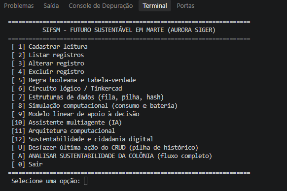

 
### 12.1.1 Evidência Opção 1 — Cadastrar leitura

**Objetivo:** demonstrar o cadastro, a validação dos campos e a
classificação de risco, com registro de alerta quando aplicável.

**Entradas e saída:**  
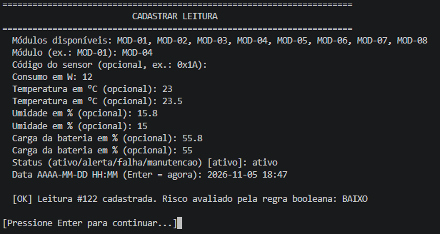


### 12.1.2 Evidência Opção 2 — Listar registros
**Objetivo:** demonstrar a consulta dos dados armazenados e a aplicação
dos filtros disponíveis.

**Saída:**  
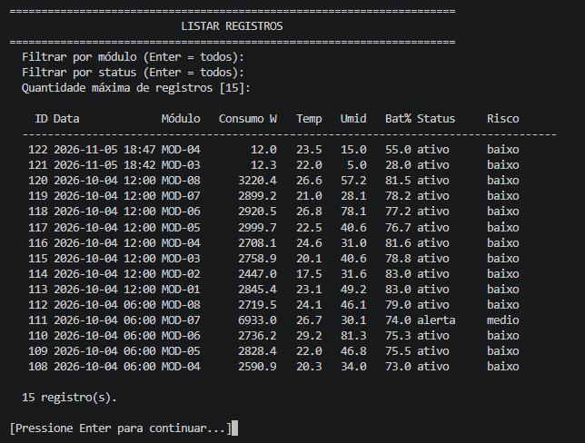


### 12.1.3 Evidência Opção 3 — Alterar registro

**Objetivo:** demonstrar a alteração de uma leitura e confirmar a
persistência dos novos valores por consulta posterior.

**Entradas e saída:**  
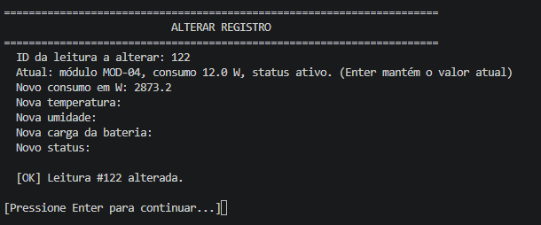


### 12.1.4 Evidência Opção 4 — Excluir registro

**Objetivo:** demonstrar a confirmação da exclusão e verificar que o
registro deixou de aparecer nas consultas.

**Saída:**  
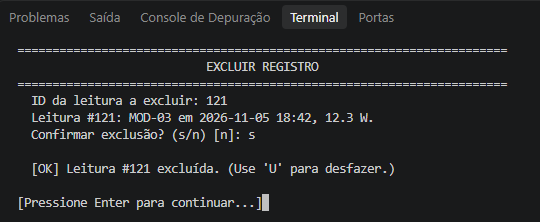


### 12.1.5 Evidência Opção U — Desfazer a última ação

**Objetivo:** demonstrar o uso da pilha para reverter a última operação
do CRUD realizada na mesma sessão.

**Entradas e saída:**  
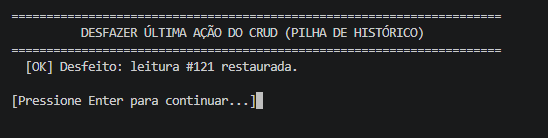


### 12.1.6 Evidência Opção 5 — Regra booleana e tabela-verdade

**Objetivo:** apresentar as combinações das entradas e verificar sua
correspondência com as regras:

**Saída:**  
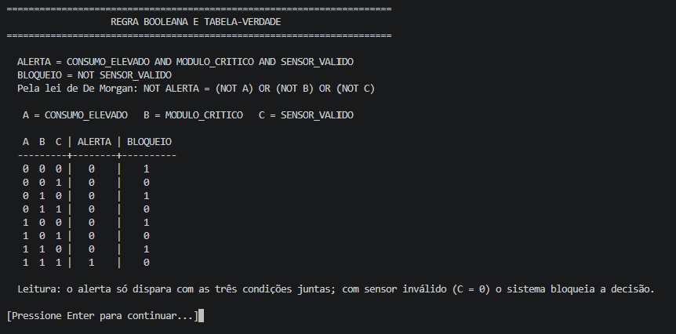


### 12.1.7 Evidência Opção 6 — Circuito lógico

**Objetivo:** demonstrar a correspondência entre a regra implementada
em Python e a representação por portas lógicas.

**Saída:**  
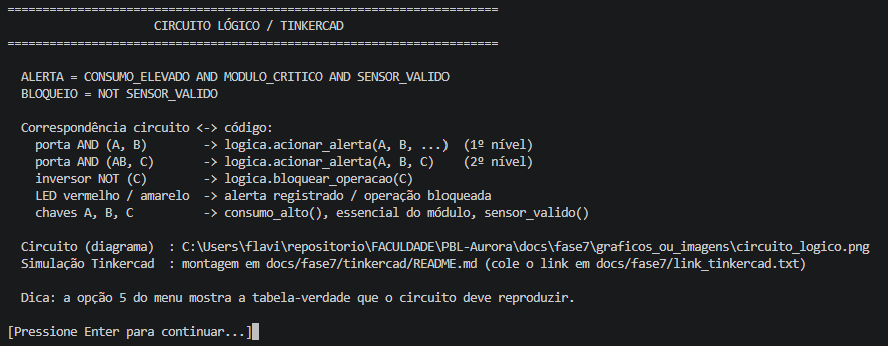


**Representação do circuito:**  
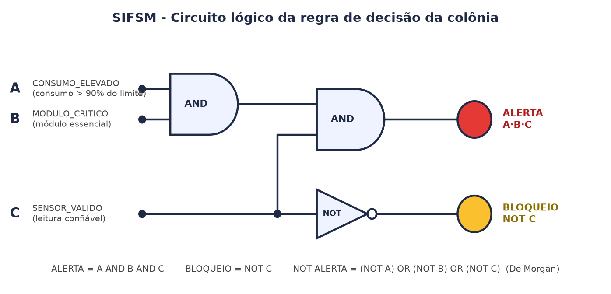


### 12.1.8 Evidência  Opção 7 — Estruturas de dados

**Objetivo:** demonstrar a aplicação de fila, pilha, tabela hash e heap
na organização de chamados, histórico, sensores e alertas.

**Saída:**  
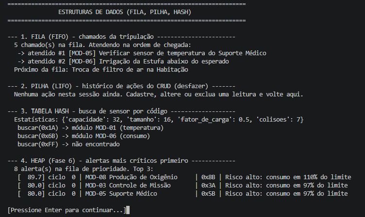


### 12.1.9 Evidência Opção 8 — Simulação energética

**Objetivo:** demonstrar integração numérica, potência média, comparação
de cenários e evolução do estado de carga de uma bateria ideal.


**Saída:**  
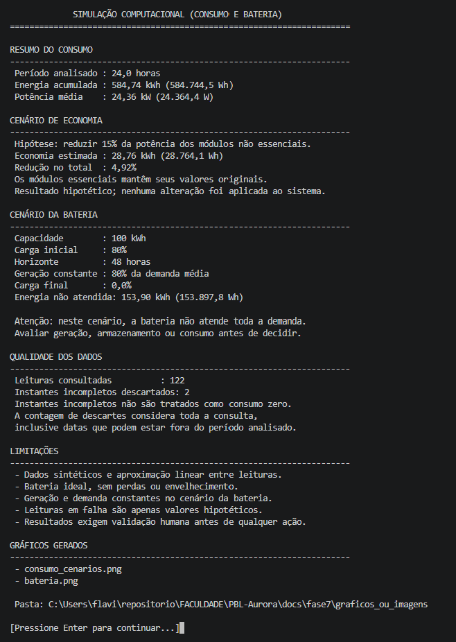


*Gráficos:**  
- Comparação dos cenários de consumo  
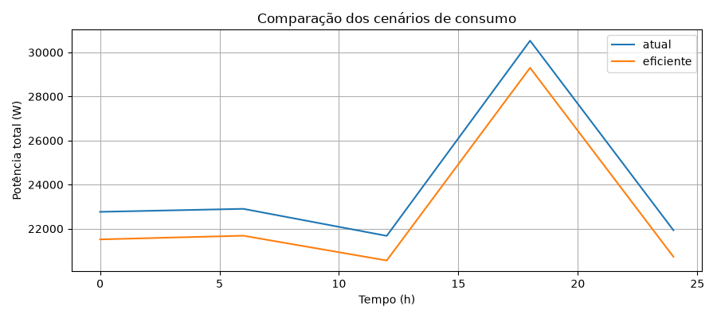

- Estado de carga da bateria ideal  
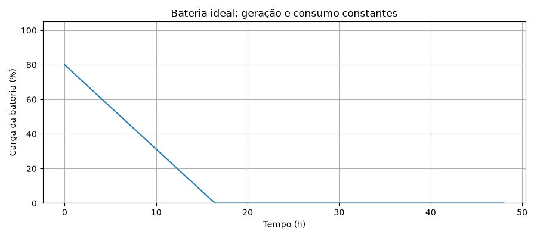


### 12.1.10 Evidência Opção 9 — Modelo linear de apoio à decisão

**Objetivo:** apresentar análise exploratória, correlações, equação,
interpretação dos coeficientes e avaliação do modelo.


**Saída completa:**  
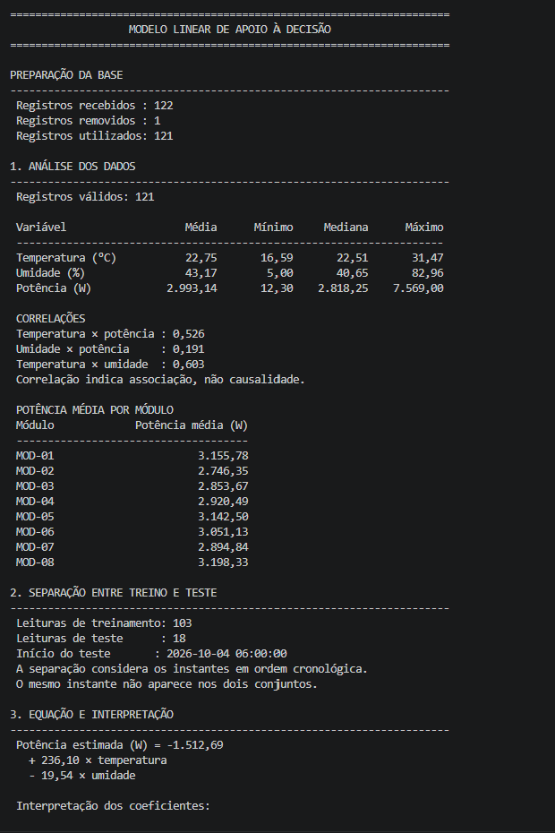
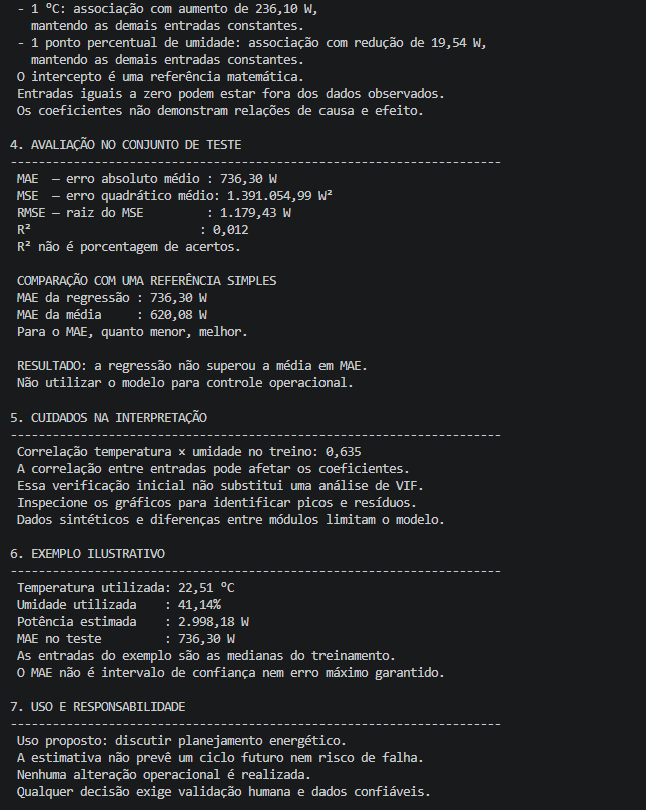
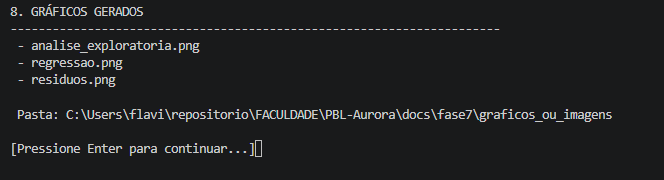

**Gráficos:**  
- Análise exploratória  
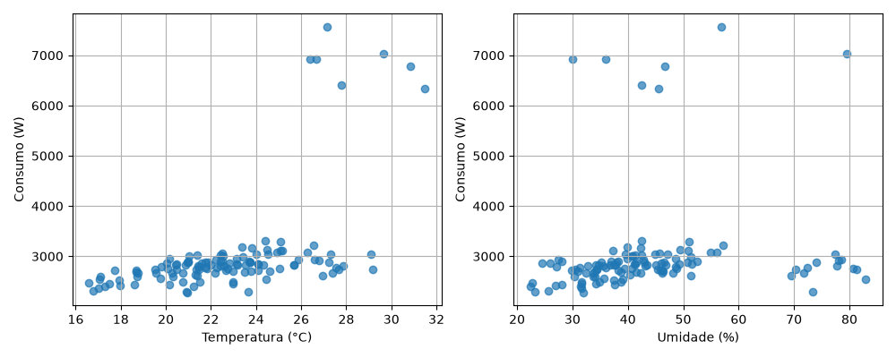

- Consumo observado e previsto  
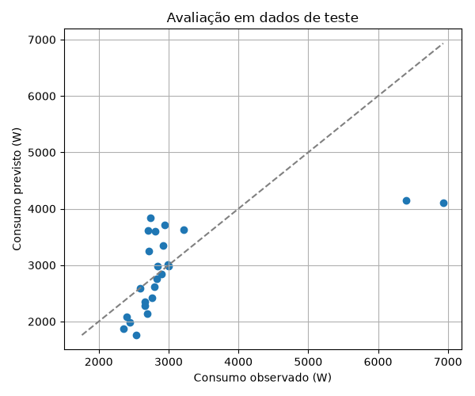

- Resíduos no conjunto de teste  
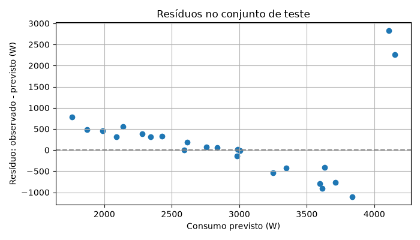


### 12.1.11 Evidência Opção 10 — Assistente multiagente simulado

**Objetivo:** demonstrar triagem, especialistas, ferramentas determinísticas,
handoffs, guardrails, contexto de sessão e tracing.


**Saída:**  
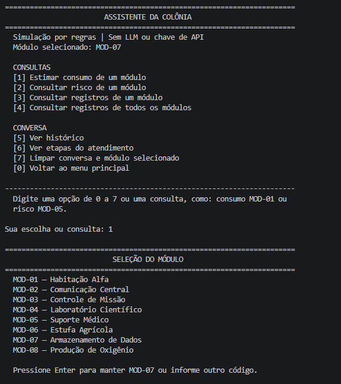
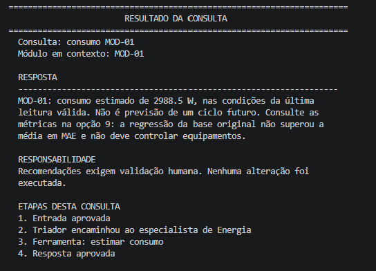


### 12.1.12 Evidência Opção 11 — Arquitetura computacional

**Objetivo:** apresentar a relação entre o protótipo, processamento local,
CPU, aceleradores, memória, movimentação de dados e eficiência.

**Saída:**    
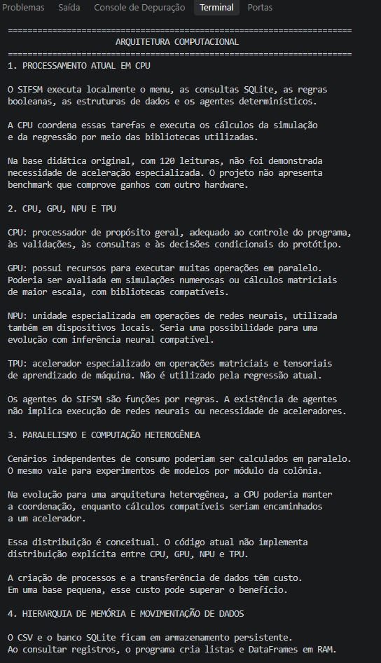

As propostas de uso de GPU, NPU ou TPU são conceituais, salvo quando
acompanhadas de implementação e medições efetivamente realizadas.


### 12.1.13 Evidência Opção 12 — Sustentabilidade e cidadania digital

**Objetivo:** apresentar uma análise vinculada ao sistema, abordando
pelo menos quatro temas previstos no item 5.8 do enunciado.

**Saída:**    
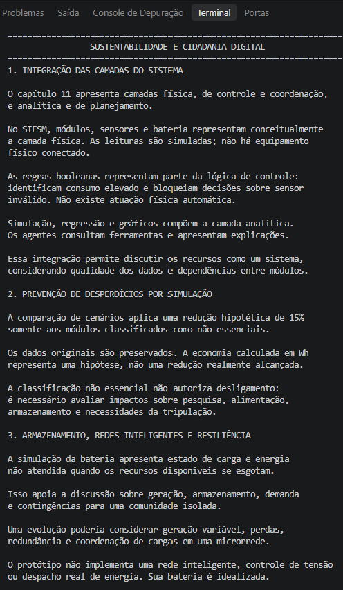


### 12.1.14 Evidência Opção A — Análise integrada de sustentabilidade

**Objetivo:** demonstrar a integração entre banco, regra de risco,
estruturas de dados, simulação, regressão e agentes.

A execução registrada concluiu as seguintes etapas:

1. Consulta de 120 leituras e identificação de oito módulos.
2. Classificação da última leitura de cada módulo.
3. Apresentação da ordem de revisão dos módulos.
4. Simulação de consumo, comparação de cenários e bateria.
5. Treinamento e avaliação da regressão.
6. Consultas aos especialistas de dados, manutenção e energia.
7. Apresentação da análise final e das limitações.

Os oito módulos apresentaram risco baixo nas últimas leituras. Essa
classificação não representa o pior risco de todo o histórico e não
significa ausência garantida de falhas.

O tracing registrou guardrails de entrada e saída, handoffs e chamadas
às ferramentas. A análise final identificou déficit no cenário de bateria
e informou que a regressão não superou a média em MAE.

O fluxo terminou sem erro na execução apresentada. Isso demonstra o
funcionamento do cenário registrado, sem comprovar todos os casos
possíveis ou adequação operacional.

**Saída:**  
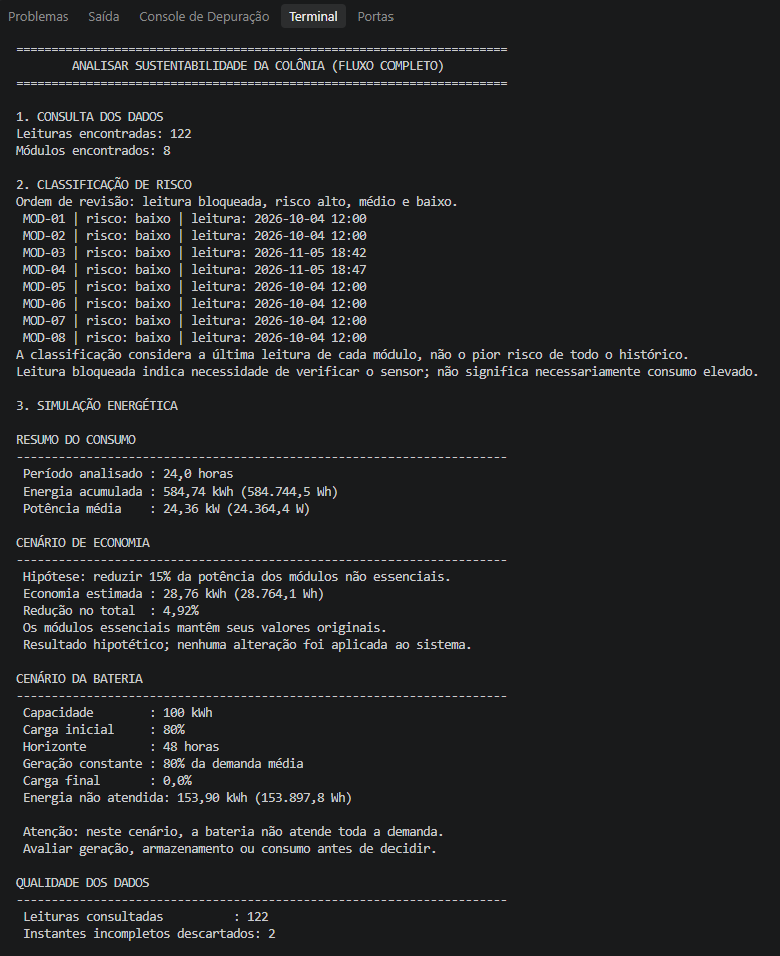


### 12.2 Testes automatizados
Os testes devem ser executados pelo pytest, a partir da raiz do projeto.

```powershell
.\venv\Scripts\python.exe -m pytest -q
```


### 12.2.1 Suíte completa do projeto
Comando:  
```powershell
python -m pytest -q
```

**Resultado final:**  
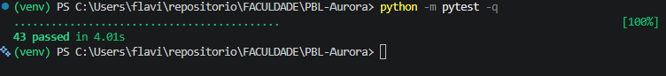


### 12.2.2 Testes da estrutura de dados
Os quatro testes automatizados das estruturas de dados passaram, verificando a ordem FIFO da fila, a ordem LIFO e o limite da pilha, as operações e o redimensionamento da tabela hash e a priorização de alertas pelo heap.

Comando:  
```powershell
python -m pytest tests/test_fase7_estruturas.py -v
```

**Resultado da execução:**  
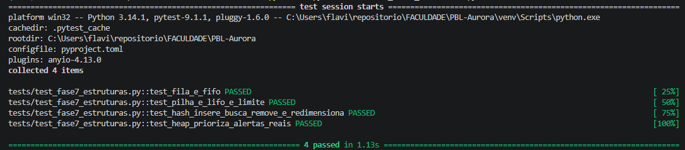


### 12.2.3 Testes do Banco de dados
Os 18 testes automatizados do banco de dados passaram, verificando persistência, operações CRUD, filtros, validação de entradas, importação do CSV, proteção contra SQL injection e registros de alertas e chamados.

Comando:  
````powershell
python -m pytest tests/test_fase7_banco.py -v
````

**Resultado da execução:**  
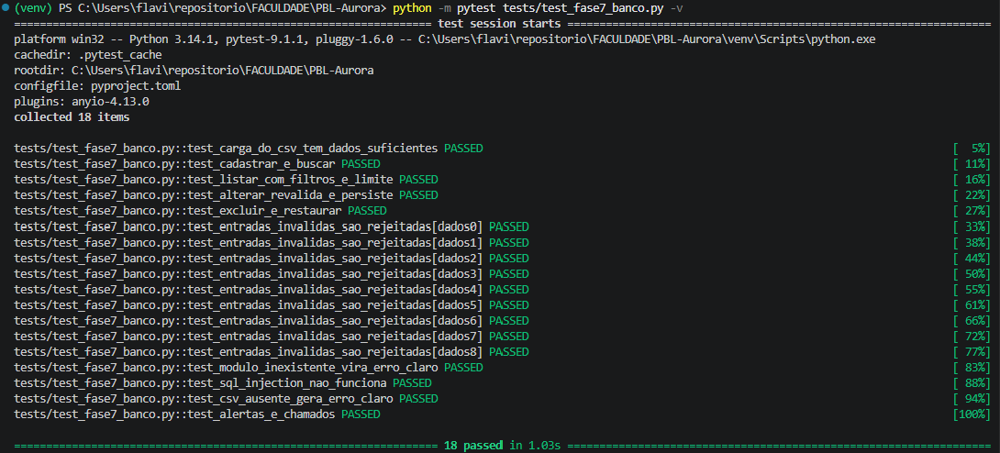


### 12.2.3 Testes da lógica
Os nove testes automatizados da lógica passaram, verificando a tabela-verdade, a lei de De Morgan, o limiar de consumo elevado, a validade dos sensores e os quatro níveis de classificação de risco.

Comando:  
```powershell
python -m pytest tests/test_fase7_logica.py -v
```

**Resultado da execução:**   
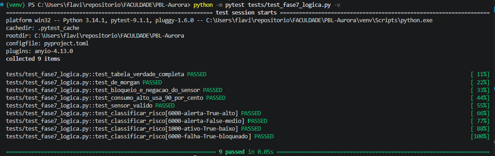


### 12.2.4 Testes da simulação energética

Comando:  
```powershell
python -m pytest tests/test_fase7_analise.py -v -k "integracao or bateria or cenario"
```
A execução ocorreu em Windows, com Python 3.14.1 e pytest 9.1.1.

**Resultado da execução:**  
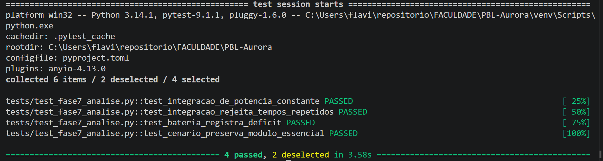


Os dois testes não selecionados foram excluídos pelo filtro de execução
e não representam falhas. Os quatro resultados validam os casos testados,
sem comprovar a precisão física da simulação.


### 12.2.5 Testes de regressão e agentes

Comando:  
```powershell
python -m pytest tests/test_fase7_analise.py -v
```

Além da simulação, esse arquivo verifica uma relação linear conhecida,
a rejeição de extrapolação e o fluxo de guardrails, handoff e sessão
dos agentes.

**Resultado da execução:**  
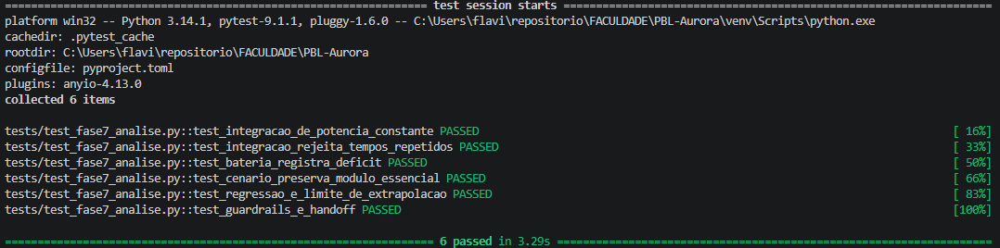


### 12.2.6 Verificação de sintaxe

Comando:  
```powershell
python -m py_compile codigo_fonte.py src/fase7_sifsm/simulacao.py src/fase7_sifsm/modelo_linear.py src/fase7_sifsm/agentes.py
```

A ausência de mensagens indica que não foram encontrados erros de sintaxe
nos arquivos verificados. Essa verificação não substitui os testes
automatizados nem a execução das funcionalidades.


**Resultado da execução:**  
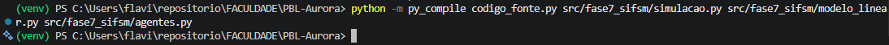


## 13. Vídeo Pitch e Roteiro de Apresentação

O vídeo pitch da Fase 7 apresenta o funcionamento completo do SIFSM, as principais decisões técnicas e os resultados obtidos. Está disponível no YouTube, na modalidade “Não listado”, pelo link **[https://youtu.be/msr6JTp80uk](https://youtu.be/msr6JTp80uk)**, também registrado em `docs/fase7/link_video.txt` (e o roteiro detalhado encontra-se em `docs/fase7/roteiro_apresentacao.md`).

### Estrutura da Apresentação (Até 5 minutos)

| Bloco | Tempo Sugerido | Responsável | Demonstração no Terminal / Evidência |
|---|---|---|---|
| **1. Abertura, Banco SQLite e CRUD** | `0:00 – 1:00` | Integrante 1 | Execução de `python codigo_fonte.py`, esquema `script_banco.sql` (5 tabelas), opções `1` a `4` (validação `ErroBanco`, queries parametrizadas) e opção `U` (desfazer com `PilhaHistorico`). |
| **2. Regra Booleana, Circuito e Estruturas** | `1:00 – 1:50` | Integrante 1 | Opção `5` (tabela-verdade `ALERTA = A ∧ B ∧ C`, `BLOQUEIO = ¬C` e De Morgan), opção `6` (`circuito_logico.png` / Tinkercad) e opção `7` (`FilaChamados` FIFO, `PilhaHistorico` LIFO, `TabelaSensores` Hash e `HeapAlertas`). |
| **3. Simulação Energética e Modelo Linear** | `1:50 – 3:00` | Integrante 2 | Opção `8` (Regra dos Trapézios: `584,74 kWh`, economia hipotética de `28,76 kWh` / `4,92%`, SoC e déficit de `153,90 kWh` da bateria) e opção `9` (AED, separação temporal 80/20, `MAE = 589,07 W` vs. `MAE_baseline = 555,51 W`, bloqueio de extrapolação). |
| **4. Assistente Multiagente Determinístico** | `3:00 – 3:50` | Integrante 2 | Opção `10` (guardrails de entrada/saída, `Triador` → *handoff* → especialistas `Energia`, `Manutenção` e `Dados`, memória de sessão e trilha de auditoria). |
| **5. Arquitetura, Sustentabilidade e Fluxo Integrado** | `3:50 – 5:00` | Integrante 3 | Opções `11` e `12` (CPU vs. GPU/NPU/TPU, hierarquia de memória, privacidade Zero-PII, *Human-in-the-Loop*, explicabilidade e ESG), fechando com a opção `A` (**Analisar sustentabilidade da colônia**) e `pytest -q` (`43 passed`). |


