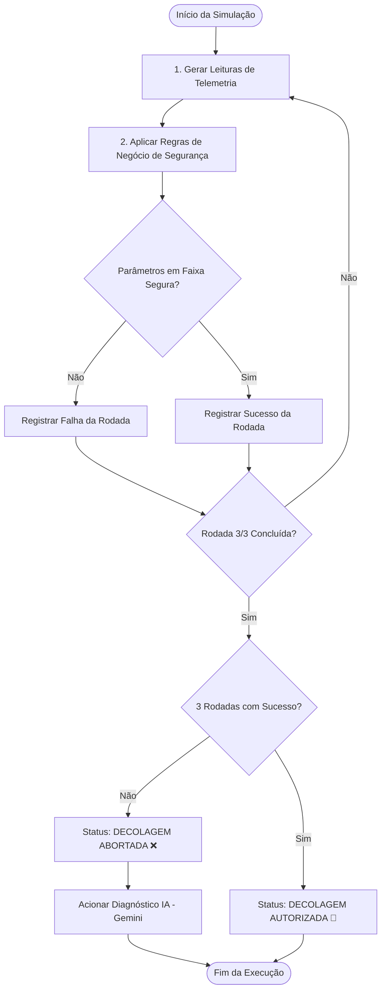

# 🚀 Fase 1: Simulação de Telemetria e Validação de Lançamento

<span class="mission-patch">PHASE 1</span>
<span class="mission-patch cyan">PRE-FLIGHT TELEMETRY</span>
<span class="mission-patch green">GATE CHECK GO / NO-GO</span>

A **Fase 1** concentra a análise inicial da missão espacial, realizando a triagem de segurança e checagem de pré-lançamento da espaçonave Aurora Siger para autorizar ou abortar a decolagem em direção a Marte.

---

## 1. Objetivo Operacional

- **Simulação de Telemetria**: Leitura em tempo real de grandezas críticas da nave (temperatura interna e externa, capacidade de bateria, taxa de consumo, perdas elétricas, pressão dos tanques e módulos vitais).
- **Sequência de 3 Testes Obrigatórios**: A decolagem somente é autorizada se as condições de segurança forem 100% satisfeitas em 3 rodadas consecutivas de verificação.
- **Diagnóstico com Inteligência Artificial (Gemini)**: Em caso de falha em qualquer rodada, o sistema aciona o modelo generativo para interpretação técnica das causas-raiz e geração de relatório de contingência.

---

## 2. Regras de Negócio e Limites de Segurança

Para que uma rodada seja classificada como **SUCESSO**, todos os critérios abaixo devem ser atendidos simultaneamente:

| Parâmetro Monitorado | Faixa Operacional Segura | Risco de Violação |
|---|---|---|
| **Temperatura Interna** | Entre $18^\circ\text{C}$ e $25^\circ\text{C}$ | Hipotermia ou superaquecimento da tripulação |
| **Temperatura Externa** | Entre $5^\circ\text{C}$ e $38^\circ\text{C}$ | Congelamento de sensores ou estresse térmico |
| **Pressão dos Tanques** | Entre $300\text{ psi}$ e $450\text{ psi}$ | Despressurização ou explosão de tanques |
| **Autonomia Energética Pós-Decolagem** | Mínimo de $80\%$ da capacidade útil | Blackout elétrico antes da órbita de injeção |
| **Módulos Críticos** | Status `OK` em todos os subsistemas | Falha de suporte à vida ou propulsão |

### Equação de Autonomia Energética:
$$\text{Energia Bruta} = \text{Capacidade} \times \left(\frac{\text{Carga \%}}{100}\right)$$
$$\text{Autonomia Pós-Decolagem (\%)} = \left(\frac{\text{Energia Bruta} - \text{Perdas} - \text{Consumo Estimado}}{\text{Capacidade}}\right) \times 100$$

---

## 3. Fluxo de Decisão da Missão



---

## 4. Implementação no Código-Fonte (`src/fases_anteriores/fase1.py`)

A função `executar_fase1()` orquestra o loop de 3 iterações, gerando logs formatados com largura de 85 colunas e retornando um dicionário estruturado para a máquina de estados em `main.py`:

```python
return {
    "status": "GO" if testes_sucessos == 3 else "ABORTADO",
    "sucessos": testes_sucessos,
    "falhas": testes_falhas,
    "erros_detectados": lista_erros,
    "autonomia_media": autonomia_calculada
}
```
