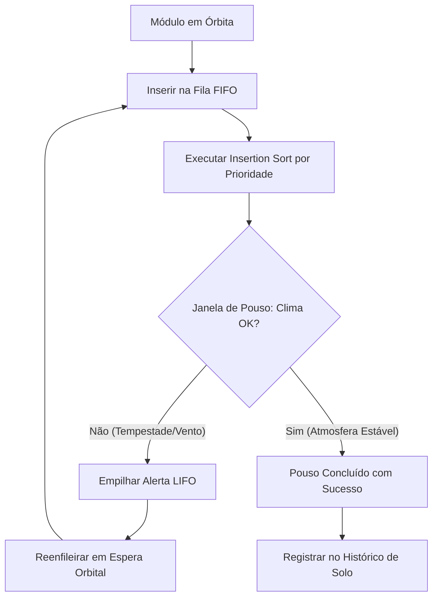

# 🛬 Fase 2: Aproximação e Pouso Espacial em Marte (MGPEB)

<span class="mission-patch">PHASE 2</span>
<span class="mission-patch cyan">MGPEB DESCENT</span>
<span class="mission-patch green">INSERTION SORT & QUEUES</span>

A **Fase 2** gerencia a aproximação e pouso em solo marciano dos módulos de carga e infraestrutura que compõem a base Aurora Siger através do **MGPEB (Módulo de Gerenciamento de Pouso Espacial Base)**.

---

## 1. Desafios Operacionais da Descida Orbital

1. **Ordenação por Criticidade**: Módulos com suporte à vida humana e centros vitais de comunicação devem ter prioridade absoluta de descida sobre laboratórios e estufas agrícolas.
2. **Clima Marciano Adverso**: Fenômenos atmosféricos súbitos em Marte (Tempestades de Areia com partículas eletrostáticas, Cisalhamento de Vento e Frio Extremo) podem forçar o aborto imediato do pouso.
3. **Estruturas de Dados Múltiplas**:
   - **Fila FIFO (First-In, First-Out)**: Fila de aproximação dos módulos à janela de descida.
   - **Pilha LIFO (Last-In, First-Out)**: Pilha de alertas e eventos de contingência para reversão de emergência.
   - **Lista Sequencial**: Histórico ordenado de módulos que tocaram o solo com sucesso.

---

## 2. O Algoritmo de Ordenação: Insertion Sort

Para reordenar a fila de pouso em tempo de execução garantindo que o módulo de maior urgência (prioridade numérica 1) desça primeiro, o sistema implementa o **Insertion Sort**:

```python
def ordenar_fila_por_prioridade(fila):
    """
    Algoritmo: Insertion Sort (Ordenação por Inserção).
    Reorganiza a fila garantindo que módulos com prioridade 1 
    fiquem no início da sequência.
    """
    for i in range(1, len(fila)):
        chave = fila[i]
        j = i - 1
        while j >= 0 and chave["prioridade"] < fila[j]["prioridade"]:
            fila[j + 1] = fila[j]
            j -= 1
        fila[j + 1] = chave
```

### Análise de Complexidade:
- **Melhor Caso**: $O(n)$ quando a fila já chega pré-ordenada pela telemetria orbital.
- **Pior e Médio Caso**: $O(n^2)$ com consumo de memória auxiliar $O(1)$ (in-place), ideal para processadores embarcados com restrição de memória física.

---

## 3. Simulação de Clima Marciano e Contingência

Antes de autorizar a entrada na camada atmosférica inferior, o sistema invoca `analisar_clima_marciano()`:
- Probabilidade de anomalia climática: $40\%$.
- Em caso de clima adverso, o módulo atual é empurrado para a **Pilha de Alertas** (LIFO) e recolocado no fim da fila de espera em órbita segura.


