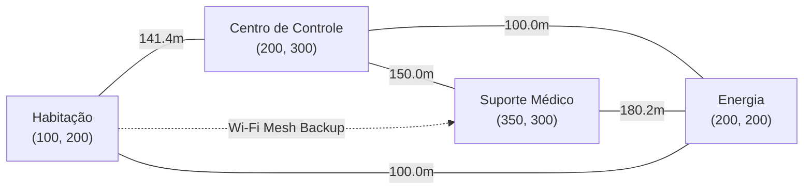

# 🕸️ Fase 4: Infraestrutura & Redes da Colônia (SIGIC)

PHASE 4
SIGIC INFRASTRUCTURE
GRAPH THEORY & ADJACENCY

A **Fase 4** estrutura o **SIGIC (Sistema Inteligente de Gerenciamento da Infraestrutura da Colônia)**, modelando a distribuição espacial da base e seus enlaces de telecomunicações através de **Teoria dos Grafos** e **Matrizes de Adjacência**.

---

## 1. Modelagem em Grafos

A base é representada formalmente como um grafo não direcionado ponderado $G = (V, E)$, onde:
- **Vértices ($V$)**: Os 8 módulos distribuídos na superfície marciana (Habitação, Centro de Controle, Armazenamento de Energia, Suporte Médico, etc.).
- **Arestas ($E$)**: Conexões físicas de cabeamento elétrico e enlaces de dados (Ethernet, RF e Wi-Fi Mesh).
- **Pesos ($W$)**: Distâncias euclidianas em metros e latências de propagação de sinal em milissegundos.

---

## 2. Coordenadas Espaciais e Distâncias Euclidianas

Cada módulo possui coordenadas cartesianas $(x, y)$ mapeadas na área de assentamento da base. A distância física entre dois módulos $A$ e $B$ é calculada por:

$$d(A, B) = \sqrt{(x_B - x_A)^2 + (y_B - y_A)^2}$$

Essa distância determina o comprimento de cabeamento requerido e o limite inferior de atenuação de sinal de rádiofrequência.

---

## 3. Matriz de Adjacência e Topologia de Telecomunicações

A conectividade da rede é mantida em memória através de uma **Matriz de Adjacência**, permitindo consultas de vizinhança e roteamento com custo $O(1)$ por par de nós:

| Módulo Origem | Habitação | Controle | Energia | Suporte Médico | Tipo de Enlace |
|---|---|---|---|---|---|
| **Habitação** | $0$ | $1$ | $1$ | $1$ | Wi-Fi Mesh + Cabo Primário |
| **Controle** | $1$ | $0$ | $1$ | $1$ | Ethernet Blindada + RF |
| **Energia** | $1$ | $1$ | $0$ | $1$ | Barramento de Alta Potência |
| **Suporte Médico**| $1$ | $1$ | $1$ | $0$ | Linha Dedicada Crítica |

---

## 4. Integração com a Máquina de Estados

O SIGIC sincroniza dinamicamente o status dos nós do grafo com as fases antecedentes:
- Recebe o status de pouso da **Fase 2**: módulos ainda em órbita constam com status `aguardando_pouso` e peso de enlace infinito.
- Recebe o diagnóstico de potência da **Fase 3**: se o armazenamento de energia sofrer corte de carga, o nó correspondente é marcado em modo de restrição.
