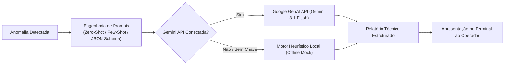

# 🧠 Fase 5: Núcleo Cognitivo da Aurora Siger (NCAS)

PHASE 5
NCAS COGNITIVE
BOOLEAN LOGIC & GEMINI AI

A **Fase 5** implementa o **NCAS (Núcleo Cognitivo da Aurora Siger)**, responsável pela camada de inteligência operacional, simplificação lógica de alarmes através de **Álgebra Booleana**, persistência estruturada e suporte à decisão com **Inteligência Artificial Generativa**.

---

## 1. Lógica Proposicional e Teoremas de De Morgan

Em ambientes de suporte à vida em Marte, condições redundantes de alarme precisam ser simplificadas para evitar circuitos com latência de portas lógicas ou códigos condicionais excessivamente aninhados.

### Teoremas de De Morgan:
$$\neg (A \lor B) \iff \neg A \land \neg B$$
$$\neg (A \land B) \iff \neg A \lor \neg B$$

### Aplicação na Validação de Alertas Críticos:
Na verificação de despressurização ou falha térmica, se um módulo estiver com sensor térmico fora da faixa segura ($T$) **OU** pressão anômala ($P$), e simultaneamente a energia estiver comprometida ($E$), o alarme tradicional avaliava:

$$\text{Alerta} = \neg (\neg T \land \neg P) \land \neg (\text{Energia Nominal})$$

Pela simplificação booleana aplicada no código:
$$\text{Alerta} = (T \lor P) \land (\text{Energia Comprometida})$$

Isso garante execução direta em tempo constante e sem ambiguidade lógica na tomada de decisão.

---

## 2. Persistência de Dados (JSON & Append-Only Log)

O NCAS desacopla o estado corrente da base e o histórico imutável:
- **`data/processed/dados_colonia.json`**: Representação em tempo real do estado de cada módulo, consumos atuais e indicadores vitais.
- **`data/processed/registros_colonia.txt`**: Diário de bordo sequencial (*append-only*), registrando timestamps astronômicos, intervenções manuais da tripulação e anomalias registradas.

---

## 3. Engenharia de Prompts com Google Gemini

O sistema integra a API do **Google Gemini (gemini-3.1-flash-lite / gemini-2.5)** através da biblioteca oficial `google-genai`:

### Técnicas de Prompt Aplicadas:
1. **Zero-Shot Prompting**: Triagem instantânea de severidade de anomalias operacionais.
2. **Few-Shot Prompting**: Fornecimento de pares de exemplo de telemetria espacial e diagnóstico para orientar o formato do parecer técnico do modelo.
3. **Structured Outputs**: Solicitação de respostas em schema rígido contendo `causa_raiz`, `nivel_risco` e `plano_de_acao_imediato`.

::: tip [PROTOCOLO DE SEGURANÇA: TOLERÂNCIA A BLACKOUT]
Se a estação perder a conexão de rede ou a chave `GEMINI_API_KEY` não for configurada no arquivo `.env`, o método `simular_resposta_assistente()` assume automaticamente, garantindo que o programa nunca sofra interrupções ou quebras durante uma operação crítica.
:::
