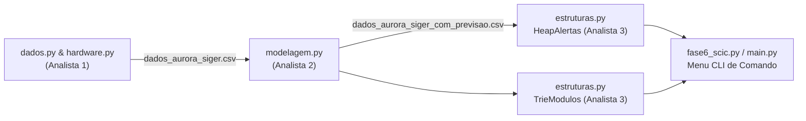

# 🔬 Fase 6: Sistema Computacional Integrado da Colônia (SCIC)

PHASE 6
SCIC INTEGRATED SYSTEM
HARDWARE, ML & DATA STRUCTURES

A **Fase 6** constitui o ápice da engenharia da Missão Aurora Siger: o **SCIC (Sistema Computacional Integrado da Colônia)**. Desenvolvido para operar em um pipeline automatizado, ele une dimensionamento de hardware, modelagem estatística com aprendizado de máquina e estruturas de dados de alta performance.

---

## 1. Visão Geral do Pipeline SCIC

---

## 2. Analista 1: Hardware & Gestão de Telemetria

### 2.1 Leis Elétricas e Diagnóstico Térmico
- **Potência Elétrica**: $P = V \times I$ (`calcular_potencia`). Tensões nominais de $220\text{--}240\text{ V}$ e correntes de $5\text{--}30\text{ A}$ resultam em potências de $1.1\text{ kW}$ a $7.2\text{ kW}$.
- **Lei de Ohm**: $R = \frac{V}{I}$ (`calcular_resistencia`).
- **Diagnóstico Térmico**: Se $P > \text{limite\_potencia\_w}$, o módulo entra imediatamente em estado de **Sobrecarga no Barramento Elétrico**.

### 2.2 Bases Numéricas e Registradores Embarcados (Hex/Bin)
Cada sensor da base possui um registrador de hardware em formato hexadecimal (ex.: `0x2A`). A função `decodificar_registrador_telemetria` emula a leitura direta do circuito embarcado:
$$\text{0x2A} \longrightarrow 42 \text{ (decimal)} \longrightarrow \text{00101010}_2 \text{ (binário de 8 bits)}$$

### 2.3 Dataset Sintético Padronizado
- **Arquivo**: `data/processed/dados_aurora_siger.csv` (120 registros: 15 ciclos $\times$ 8 módulos).
- **Reprodutibilidade Estrita**: Gerado com `numpy.random.default_rng(seed=42)`.
- **Validação Rigorosa**: O método `verificar_problemas` valida as 20 colunas, faixas físicas de temperatura, pressão, radiação e confere a consistência de $P \approx V \times I$ com tolerância de ponto flutuante de $0.01\text{ W}$.

---

## 3. Analista 2: Modelagem Estatística, ML & Métricas

### 3.1 Previsão de Latência de Rede
Utiliza algoritmos de regressão (`LinearRegression` e `Ridge` com regularização e `GridSearchCV`) para prever a latência observada em milissegundos a partir de atributos físicos (tensão, corrente, potência, temperatura, pressão, radiação e prioridade).

### 3.2 Critério Tripartite de Erro Relativo
O sistema classifica os desvios entre latência observada ($y$) e prevista ($\hat{y}$):
$$\text{Erro Absoluto} = |y - \hat{y}| \quad (\text{ms})$$
$$\text{Erro Relativo} = \left|\frac{y - \hat{y}}{y}\right| \times 100\%$$

| Faixa de Erro | Limiar Percentual | Classificação Operacional | Ação do Sistema |
|---|---|---|---|
| **Verde** | Até $5\%$ | **ACEITÁVEL** | Operação nominal |
| **Âmbar** | Entre $5\%$ e $15\%$ | **ATENÇÃO** | Monitoramento preventivo |
| **Vermelha** | Acima de $15\%$ | **PREOCUPANTE** | Geração de Alerta de Rede no Heap |

### 3.3 Métricas de Avaliação
- **MAE** (Erro Médio Absoluto): Média da magnitude dos erros na mesma unidade da telemetria ($\text{ms}$).
- **MSE / RMSE** (Raiz do Erro Médio Quadrático): Penaliza desvios abruptos na rede.
- **$R^2$**: Fração da variância da latência explicada pelas condições elétricas e climáticas dos módulos.
- **Critérios de Informação AIC e BIC**: Penalizam complexidade de modelo para evitar *overfitting* em tempo real.

---

## 4. Analista 3: Estruturas de Dados Avançadas

### 4.1 Fila de Prioridade com Max-Heap Binário (`HeapAlertas`)
Diferente de listas comuns que exigem $O(n)$ para busca ou inserção, o Max-Heap binário organiza os alarmes pela sua criticidade em **$O(\log n)$**, permitindo acesso imediato ao alerta mais severo em **$O(1)$**.

#### Fórmula de Cálculo da Criticidade Ponderada:
$$\text{Pontuação} = \text{Peso}_{\text{Status}} + \text{Peso}_{\text{Mensagem}} + \text{Peso}_{\text{Faixa Erro}} + (15 \times \text{Essencial}) + (5 \times \text{Prioridade})$$

- $\text{Peso}_{\text{Status}}$: `alerta` $= 40$, `manutencao` $= 10$, `ativo` $= 0$.
- $\text{Peso}_{\text{Mensagem}}$: Sobrecarga elétrica $= 30$, Radiação $= 25$, Latência $= 20$.
- $\text{Peso}_{\text{Faixa Erro}}$: Preocupante $= 20$, Atenção $= 8$, Aceitável $= 0$.

### 4.2 Árvore de Prefixos (`TrieModulos`)
A `Trie` indexa em tempo de execução:
- Identificadores de módulos: `MOD-01`, `MOD-02`...
- Nomes dos módulos: `Habitação Alfa`, `Comunicação Central`...
- Códigos hexadecimais de sensores: `0x1A`, `0x2A`...
- Comandos do sistema: `alertas`, `diagnostico`, `status`...

A busca por prefixo executa em tempo **$O(m)$**, onde $m$ é o tamanho do prefixo digitado pelo operador, sendo totalmente imune ao crescimento do número total de registros $n$ da colônia.

---

## 5. Benchmark: Heap vs Lista Sequencial

A função `comparar_heap_vs_lista` compara empiricamente a performance de extrair $N$ alertas ordenados:

| Estrutura de Dados | Custo de Inserção | Custo de Extração Máxima | Comportamento sob Carga |
|---|---|---|---|
| **Lista Não Ordenada** | $O(1)$ | $O(n)$ | Inviável para telemetria com alta taxa de amostragem |
| **Lista Ordenada** | $O(n)$ | $O(1)$ | Custo proibitivo na chegada contínua de eventos |
| **Max-Heap Binário** | $O(\log n)$ | $O(\log n)$ | **Ótimo e previsível sob rajadas de falha** |
