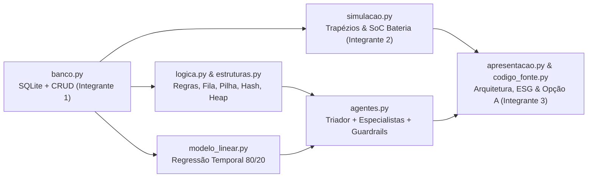

# 🌱 Fase 7: Sistema Integrado de Futuro Sustentável em Marte (SIFSM)

PHASE 7
SIFSM SUSTAINABILITY
SQLITE, AGENTS & ESG GOVERNANCE

A **Fase 7** consolida a arquitetura da Missão Aurora Siger no **SIFSM (Sistema Integrado de Futuro Sustentável em Marte)**. Operado a partir de `codigo_fonte.py`, o sistema integra banco de dados SQLite, lógica booleana e circuito digital, quatro estruturas de dados clássicas, simulação numérica de energia e bateria, regressão linear temporal, sistema multiagente determinístico com guardrails e governança socioambiental (ESG).

---

## 1. Pipeline Integrado do SIFSM

---

## 2. Integrante 1: Fundação (Banco SQLite, Lógica Booleana e Estruturas)

### 2.1 Persistência Relacional e CRUD (`banco.py` e `script_banco.sql`)
- **Esquema SQLite (`aurora_siger.db`)**: 5 tabelas normalizadas (`modulos`, `sensores`, `leituras`, `alertas`, `chamados`) com restrições `CHECK`, chaves estrangeiras e índices compostos.
- **Base Determinística**: `data/fase7/dados_aurora_siger.csv` com **120 leituras** (8 módulos × 15 ciclos de 6 h, semente `42`).
- **Segurança e Tratamento de Erros**: Consultas 100% parametrizadas (`?` contra *SQL Injection*), validação prévia em `validar_leitura()` e blocos `try/except/else/finally`.

### 2.2 Regra Booleana e Circuito Lógico (`logica.py` e Tinkercad)
- **Entradas**: $A = \text{CONSUMO\_ELEVADO}$ ($> 90\%$ do limite), $B = \text{MODULO\_CRITICO}$ (`essencial = 1`), $C = \text{SENSOR\_VALIDO}$.
- **Saídas**:
  $$\text{ALERTA} = A \land B \land C$$
  $$\text{BLOQUEIO} = \neg C$$
  $$\neg \text{ALERTA} = \neg A \lor \neg B \lor \neg C \quad \text{(Lei de De Morgan)}$$
- **Circuito Digital**: Duas portas `AND` (`74HC08`) em cascata e um inversor `NOT` (`74HC04`) — ou montagem equivalente em Arduino Uno (`docs/fase7/tinkercad/sifsm_alerta.ino`).

### 2.3 Estruturas de Dados (`estruturas.py`)
| Estrutura | Classe / Função | Complexidade | Aplicação Operacional |
|---|---|---|---|
| **Fila (FIFO)** | `FilaChamados` | $O(1)$ | Atendimento de chamados da tripulação por ordem de chegada |
| **Pilha (LIFO)** | `PilhaHistorico` | $O(1)$ no topo | Histórico de sessão para desfazer (Opção `U`) cadastros, alterações e exclusões |
| **Tabela Hash** | `TabelaSensores` | $O(1)$ médio | Busca de sensores por código hexadecimal (`0x1A`–`0x8B`) com encadeamento e *rehash* |
| **Max-Heap** | `montar_heap_de_alertas` | $O(\log n)$ | Priorização dos alertas mais críticos (reaproveitando `HeapAlertas` da Fase 6) |

---

## 3. Integrante 2: Análise (Simulação Energética, Modelo Linear e Agentes)

### 3.1 Integração Numérica e Simulação de Bateria (`simulacao.py`)
- **Regra dos Trapézios**: Integra a potência agregada dos módulos no horizonte de $24\text{ h}$:
  $$E = \sum_{i=1}^{n} \frac{P_{i-1} + P_i}{2} \cdot (t_i - t_{i-1}) \quad (\text{Wh})$$
- **Resultados de Referência (Base Original)**:
  - Consumo acumulado em $24\text{ h}$: **$584,74\text{ kWh}$** (potência média de $24,36\text{ kW}$).
  - Economia hipotética ($-15\%$ nos módulos não essenciais): **$28,76\text{ kWh}$ ($4,92\%$)**.
  - Bateria ideal ($100\text{ kWh}$, carga inicial $80\%$, $48\text{ h}$, geração a $80\%$ da demanda): **SoC final de $0\%$** e **déficit acumulado de $153,90\text{ kWh}$**.

### 3.2 Regressão Linear de Apoio à Decisão (`modelo_linear.py`)
- **Separação Temporal (80/20)**: 95 leituras de treino e 24 de teste (sem *data leakage* entre instantes).
- **Equação Ajustada**:
  $$\text{Consumo (W)} = -1491,83 + 228,35 \times \text{Temperatura (°C)} - 16,41 \times \text{Umidade (\%)}$$
- **Métricas no Conjunto de Teste**: $\text{MAE} = 589,07\text{ W}$, $\text{RMSE} = 885,97\text{ W}$ e $R^2 = 0,355$ frente ao baseline da média do treino ($\text{MAE}_{\text{baseline}} = 555,51\text{ W}$). O sistema reporta abertamente que a regressão não superou a média em MAE e bloqueia extrapolações fora do intervalo de treinamento.

### 3.3 Assistente Multiagente Determinístico (`agentes.py`)
- **Arquitetura**: `guardrail_entrada` $\rightarrow$ `agente_triador` $\rightarrow$ *handoff* (`agente_energia`, `agente_manutencao`, `agente_dados`) $\rightarrow$ ferramentas determinísticas $\rightarrow$ `guardrail_saida` $\rightarrow$ memória de `Sessao` + *tracing*.
- **Execução Local**: Opera 100% sem necessidade de chave de API externa; ferramentas somente consultam e calculam, exigindo validação humana.

---

## 4. Integrante 3: Arquitetura Computacional e Sustentabilidade (ESG)

- **Arquitetura Computacional (Item 5.7)**: Execução local em CPU para 120 registros; balanceamento conceitual *Edge* (regras booleanas nos módulos) vs. *Core Local* (`MOD-03`/`MOD-07`); análise de paralelismo e aceleradores (CPU multicore, GPU, NPU, TPU), hierarquia de memória (SSD $\rightarrow$ RAM $\rightarrow$ Caches L1/L2/L3) e mitigação de retreinamentos redundantes.
- **Sustentabilidade e Cidadania Digital (Item 5.8)**:
  1. **Privacidade vs. Vigilância**: Modelagem estritamente ambiental (Zero-PII) vinculada apenas a módulos e sensores.
  2. **Pegada Computacional**: Monitoramento do `MOD-07 (Armazenamento de Dados)` e sobriedade digital sem chamadas obrigatórias a LLMs pesados.
  3. **Supervisão Humana (*Human-in-the-Loop*)**: Bloqueio de decisões sobre sensores em falha (`BLOQUEIO = NOT C`) e agentes restritos a leitura.
  4. **Transparência e Explicabilidade**: Auditoria aberta da tabela-verdade, dos coeficientes da regressão e das limitações das métricas.
